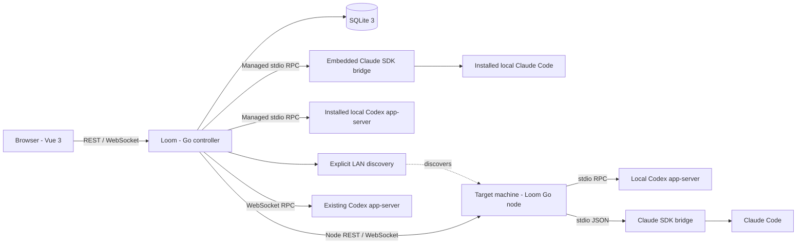
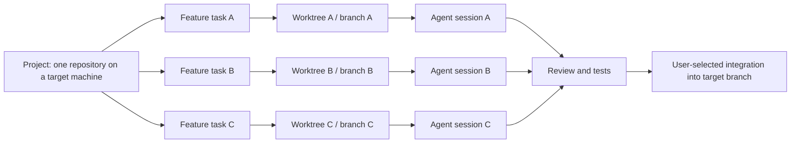
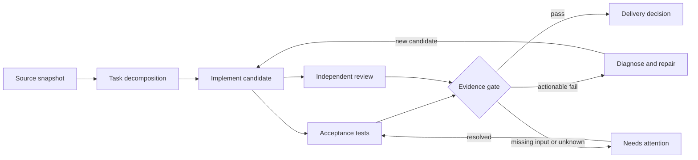

# Loom Design Document

Date: 2026-11-05. Status: local requirement worktrees, project Skills, and simulated-protocol reliability tests implemented; real model-task validation and M4 remain outstanding. Section 16 records local workspace management and the remaining integration and archival proposal.

This file is shared, version-controlled project documentation. Sections 1-14 retain the target design. Section 15 records the implemented slice and differences from proposed contracts. README commands describe the runnable application.

## 1. Project goals

Loom is a unified controller for Codex and Claude Code. Users start a Go application, confirm automatically detected local agents or configure remote services, create sessions in project directories on target machines, submit tasks, observe execution, and continue interacting.

The technology constraints are a Go backend, a Vue 3 frontend, and a SQLite 3 database. The frontend follows the organization and interactions of Times. Codex connectivity follows the existing Times backend implementation.

The first release targets a single user, a small number of machines, and concurrent sessions, with Windows and Linux as the initial platforms. The design baseline is 1-10 target machines and up to 10 concurrent tasks. This is a development and validation target, not a measured performance guarantee.

### 1.1 Required first-release behavior

1. Start the web server when the application starts and print the local browser URL.
2. Automatically discover accessible services when the page opens, with progress, empty states, and errors.
3. Configure connection credentials, add addresses manually, and reconnect saved services.
4. Connect to Codex and Claude Code and select project directories on target machines.
5. Create and restore sessions, submit text tasks, and display live responses and execution activities.
6. Display command output, tool calls, and file changes provided by the agent.
7. Handle supported approval requests and user questions, and interrupt tasks.
8. Persist connection settings, session indexes, messages, execution events, and approval results.
9. Recover task visibility after page refreshes, browser closure, or short network interruptions.

### 1.2 Later scope

Scheduling, orchestration across multiple agents, multi-user permissions, remote desktop control, a complete IDE, arbitrary terminal control, automatic Git commits and merges, attachments, and file management are deferred. Displaying available file change details remains part of the first release.

### 1.3 Integration boundaries

This design interprets "Claude" as Claude Code. Loom connects to programmable agent service endpoints. Ordinary CLI processes and desktop windows do not automatically expose a LAN service.

The current controller manages local Codex app-server and a local Claude SDK bridge, and connects to existing remote Codex app-server endpoints. Target-side Loom nodes are planned. Importing existing desktop client sessions and allowing simultaneous writes from Loom and a desktop client require separate compatibility validation. Taking over arbitrary existing windows is not a first-release commitment.

Agents run on target machines, which retain their authentication state and model provider configuration. Loom stores service connection credentials without copying model API keys or login files from target machines. A remote task's `cwd` belongs to its target machine; the controller's local filesystem cannot establish whether that directory exists.

### 1.4 Project language

Documentation, code identifiers, comments, examples, and generated project materials use English. Interface copy supports English and Simplified Chinese through shared English translation keys. `AGENTS.md` records this localized-interface exception.

## 2. Times investigation and protocol verification

The reference project is at `D:\JinYun\code\me\golang\times`. Relevant implementations were read without modifying Times.

| Source | Confirmed behavior | Application to Loom |
| --- | --- | --- |
| [server/define/config.go](D:/JinYun/code/me/golang/times/server/define/config.go) | `Codex.Address`, `Token`, and `WorkspacePath` configuration | Extend a single configured address into multiple endpoints; associate working directories with service identity |
| [server/request/globals.go](D:/JinYun/code/me/golang/times/server/request/globals.go) | `/times/v1/ai/codex` WebSocket route | Use the Go backend as the browser's entry point to agent services |
| [server/request/codex.go](D:/JinYun/code/me/golang/times/server/request/codex.go) | Upstream WebSocket, Bearer authentication, bidirectional relay, heartbeats, and thread constraints | Follow the connection approach and move protocol management into backend adapters |
| [server/request/codexRuntime.go](D:/JinYun/code/me/golang/times/server/request/codexRuntime.go) | Go-side `initialize` / `initialized` handshake and request-response correlation | Reference for backend-owned RPC connections |
| [web/src/base/codex.ts](D:/JinYun/code/me/golang/times/web/src/base/codex.ts) | Thread creation and restoration; turn submission, steering, and interruption; message and activity deltas; reconnection | Map to unified session operations and events |
| [web/src/components/ai/AiDialog.vue](D:/JinYun/code/me/golang/times/web/src/components/ai/AiDialog.vue) | Session sidebar, conversation, input, and live activities | Follow the interactions using smaller components with focused responsibilities |
| [web/src/components/ai/AiActivity.vue](D:/JinYun/code/me/golang/times/web/src/components/ai/AiActivity.vue) | Command, file, tool, and plan displays | Use unified activity types and detail cards |
| [web/package.json](D:/JinYun/code/me/golang/times/web/package.json) | Vue 3, TypeScript, Vite, Element Plus, and Markdown rendering | Select only dependencies needed for the first release |
| [ai/codex/Dockerfile](D:/JinYun/code/me/golang/times/ai/codex/Dockerfile) | app-server listens on WebSocket port 3000 with capability-token authentication | Use 3000 as a configurable native Codex probe port |

Times already connects Codex WebSocket sessions to its UI. The inspected code does not implement LAN agent discovery or a Claude adapter. Its frontend uses `approvalPolicy: never` and returns an unsupported error for server-initiated interactions. Loom must implement approvals and questions rather than treating that branch as existing support.

Times user permissions, its fixed `/workspace`, injected model configuration, and resource library behavior serve its own application. Loom designs working directories, connection credentials, default permissions, and browser origin checks independently. Actual Times credentials must not be copied.

### 2.1 Read-only local verification

- Local `codex --version`: `codex-cli 0.125.0`.
- `codex app-server --help` confirms `stdio://` and `ws://IP:PORT` transports, along with authentication options including `--ws-auth` and `--ws-token-file`.
- This version's `generate-json-schema` exported the protocol to the system temporary directory. The schemas confirm `thread/start`, `thread/resume`, `thread/read`, `turn/steer`, and server approval and question request structures. No agent task was started.
- Local `claude --version`: `2.1.78 (Claude Code)`.
- `claude --help` confirms noninteractive mode, `stream-json` input and output, partial messages, restoration by session ID, and permission modes. The help does not expose a network endpoint equivalent to Codex app-server.
- Official Claude SDK documentation was read to confirm streaming events, restoration by session ID, `canUseTool` approval callbacks, and `AskUserQuestion` interactions.

These results describe local version snapshots. Implementation must pin dependencies and verified versions. New options in current online documentation cannot be assumed to work with older CLIs. These checks do not establish that real service connectivity, login, model calls, approvals, or cross-machine integration have passed.

Official OpenAI app-server documentation was searched and retrieval was attempted, but the page returned HTTP 403. Codex contracts in this document are based on Times source and schemas exported by the local CLI. Implementation must also consult the official documentation and test compatibility against target versions.

## 3. Architecture



Controller mode is implemented. Node mode is a proposed extension of the Go executable:

- **Controller mode:** the default. Runs the web server, SQLite, discovery, and connection management, and provides the browser API.
- **Node mode:** runs on a target machine. Advertises itself, authenticates the controller, validates working directories, manages local agent processes, and exposes unified interfaces.

Local Codex and Claude are managed directly by the controller without a network listener or a separate node. Existing remote Codex WebSocket services connect directly. Remote Claude will require an authenticated target node; node APIs and mDNS are not implemented.

The controller maintains one Loom SQLite database. Nodes retain identity and service configuration plus bounded in-memory event buffers. Each agent's native runtime remains responsible for its own session persistence. The first release adds neither node databases nor a central message queue.

### 3.1 Module responsibilities

| Module | Responsibility |
| --- | --- |
| HTTP service | REST routing, validation, errors, frontend assets, and SPA route fallback |
| Discovery | Network interfaces, mDNS, saved addresses, configured-port probes, and deduplication |
| Connection Manager | Credential references, dialing, handshakes, status, reconnection, and connection lifecycle |
| Provider Adapter | Translate unified operations and events to agent-specific protocols |
| Session Service | Session and turn state, operation deduplication, concurrency rules, and history projections |
| Interaction Service | Correlate approval and question requests; handle one-time replies, expiry, and cancellation |
| Event Hub | Deliver persisted events, replay cursors, and manage browser subscriptions |
| Repository | SQLite migrations, transactions, queries, and event projections |
| Node Service | Target directories and processes, node API, and short-term event replay |

The backend owns long-lived agent connections. Switching pages or closing the browser cancels only the browser subscription. It does not close agent connections or interrupt tasks. An explicit "Interrupt" action invokes interruption.

## 4. Technology and directories

### 4.1 Initial choices

- Go: provisionally `1.24+`, subject to the pinned dependencies selected during initialization.
- HTTP: Gin, following the Go web development approach used in Times.
- WebSocket: `gorilla/websocket`, with one read loop and one serialized write queue per connection.
- SQLite: `database/sql` with `modernc.org/sqlite` and SQL migrations. A pure Go driver simplifies Windows builds; an ORM is unnecessary for the first release.
- Frontend: Vue 3 Composition API, TypeScript, Vite, Vue Router, and Element Plus. Start with composable state modules; reconsider Pinia as the application grows.
- Markdown: `markdown-it` with DOMPurify. Agent text and tool results are external input and must be sanitized before rendering.
- Claude bridge: JavaScript using the TypeScript `@anthropic-ai/claude-agent-sdk` API, bundled and embedded with the controller. Node.js 22+ is required when using local Claude.
- mDNS: use a maintained Go implementation after checking platform support and maintenance status rather than implementing the DNS protocol from scratch.

Release builds embed frontend assets in the Go application. During development, Vite may serve the frontend and proxy `/api` to Go. A controller using only native Codex connectivity does not need Node.js at runtime. Local Claude additionally needs Node.js 22+; the SDK bridge is bundled into the Go executable and extracted into its data directory at runtime.

### 4.2 Proposed layout

```text
loom/
├── cmd/loom/                 # Default controller and node subcommand
├── internal/
│   ├── app/                  # Dependency assembly and lifecycle
│   ├── config/
│   ├── httpapi/
│   ├── discovery/
│   ├── connection/
│   ├── provider/
│   │   ├── codex/
│   │   └── nodeclient/
│   ├── session/
│   ├── interaction/
│   ├── event/
│   ├── storage/migrations/
│   └── node/                 # Node management and Claude bridge adapter
├── bridge/claude/            # Optional SDK bridge with dependency lockfile
├── web/
│   ├── src/
│   │   ├── api/
│   │   ├── types/
│   │   ├── composables/
│   │   ├── components/
│   │   └── views/
│   └── dist/                 # Build output; ignored by Git
├── go.mod
├── README.md
├── DESIGN.md                 # Shared, version-controlled design
└── .gitignore
```

## 5. Startup and discovery

### 5.1 Controller startup

1. Read configuration, create the local data directory, open SQLite, and run migrations.
2. Initialize connection management and the event service. Previously running turns initially require state synchronization.
3. Bind the web port, start HTTP serving, and print the actual browser URL.
4. Detect installed CLIs using bounded version probes. Reconnect configured remote endpoints and previously confirmed local agents asynchronously.
5. The page obtains a state snapshot and subscribes to events. On first use, one confirmation enables available local agents. Remote configuration is an explicit alternative.
6. LAN probing runs only through the explicit remote discovery action. An unavailable agent does not prevent access to the UI.

The default listener is `127.0.0.1:7331`. Port conflicts produce a clear error. Users can change the port through an option; the application does not silently choose another port. Automatically launching a browser is not required for the first release.

Local detection runs at startup and on explicit rescan, independently of browser tabs. Concurrent rescans reuse the active scan. First-run confirmation persists in SQLite and does not submit a task. LAN discovery is also independent of tabs, but full subnet probes now require the explicit "Discover again" action. Node advertisements remain planned.

### 5.2 Discovery sources

| Source | Default behavior | Limitations |
| --- | --- | --- |
| Installed local CLIs | Check PATH and bounded common installation locations with `--version` | Installation is detected; authentication and task compatibility remain separate |
| Saved addresses | Probe local and previously configured endpoints using stored credentials | Address changes require an update or rediscovery |
| mDNS | Browse node advertisements for `_loom-agent._tcp.local.` | Nodes must be running; VLAN boundaries or blocked multicast may prevent discovery |
| Bounded port probes | Probe configured ports, initially including 3000, across a limited set of IPv4 addresses on eligible LAN interfaces | Other ports require configuration or manual entry; all-port scanning is not performed |

mDNS TXT records contain only nonsensitive metadata such as protocol version, stable node ID, display name, and provider types. One node can expose both Codex and Claude endpoints. Advertisements identify candidates; they do not establish authentication or permission to execute tasks.

Initial probe limits are 512 IPv4 addresses per run, 32 concurrent probes, a 500ms TCP timeout, a 2s protocol handshake timeout, and a 20s total budget. Large networks retain their actual subnet boundaries. Enumeration stops at the address limit and displays "Discovery scope limited", with options to configure target ranges or enter addresses manually. Loopback, unaddressed, and down interfaces are excluded from subnet scans. VPN and virtual interfaces can be enabled in settings. Loopback services are checked separately as local candidates.

Connections are attempted only on configured ports. Native Codex identity is checked against the `initialize` response structure without creating threads or submitting tasks. An HTTP 401 or open TCP port alone does not identify Codex. Candidates with unknown credentials remain pending configuration or verification until authenticated handshakes succeed.

The first release supports IPv6 addresses returned by mDNS or entered manually, without enumerating IPv6 address space. Results are deduplicated by node ID and provider. Native Codex endpoints without stable node identity are deduplicated by normalized endpoint address.

### 5.3 Connection states

```text
discovered -> connecting -> ready
                        -> auth_required / incompatible / error
ready -> reconnecting -> ready / offline
ready -> disconnected (explicit user action)
```

The ready state establishes transport and protocol availability. Model authentication and quota availability are separate; task failures report them independently. Only configured endpoints with automatic connection enabled are reconnected automatically.

Reconnection uses exponential backoff with jitter: approximately 1, 2, 4, and 8 seconds, capped at 30 seconds. Authentication failures stop automatic retries and prompt for updated credentials. Initial heartbeat intervals are 30 seconds with a 90-second failure threshold, adjustable by adapters for their runtimes.

## 6. Agent adapters

### 6.1 Shared capabilities and interface

The browser depends only on Loom types and cannot submit arbitrary provider RPC. Adapters report capabilities including `stream`, `resume`, `interrupt`, `approvals`, `userInput`, `steer`, `listModels`, and `fileChanges`, together with versions and reasons for unavailable features.

The core Go interface has the following shape; parameter types will be defined during implementation:

```go
type AgentConnection interface {
    Capabilities() Capabilities
    CreateSession(context.Context, SessionOptions) (SessionRef, error)
    RestoreSession(context.Context, SessionRef) (SessionSnapshot, error)
    StartTurn(context.Context, TurnRequest) (TurnRef, error)
    Interrupt(context.Context, TurnRef) error
    RespondInteraction(context.Context, InteractionReply) error
    Events() <-chan AgentEvent
    Close() error
}
```

Optional operations such as steering and model enumeration use separate capability interfaces. Unsupported operations return `capability_unavailable`, and the UI omits their actions. Responses carry the relevant endpoint, session, and turn identifiers; they must not depend on a global current thread.

### 6.2 Codex

1. Connect to the configured `ws://` or `wss://` address. The backend attaches a Bearer token when required.
2. Send `initialize`, wait for success, then send the `initialized` notification.
3. Enable required experimental capabilities according to the actual runtime version. Do not assume `initialize` returns a complete feature list; support is determined from versioned schemas and compatibility tests.
4. Use `thread/start` to create sessions and `thread/read` / `thread/resume` for snapshots, restoration, and subscription synchronization.
5. Submit tasks with `turn/start`, interrupt with `turn/interrupt`, and expose `turn/steer` only after verifying support.
6. Normalize `item/agentMessage/delta`, command output, file changes, tool activities, and `turn/completed` into shared events.

The adapter owns request-response ID correlation. Server requests with IDs are handled separately from ordinary notifications. Required interactions include:

| Codex server request | Loom behavior |
| --- | --- |
| `item/commandExecution/requestApproval` | Display the command, directory, reason, and available choices; map `accept`, `decline`, and `cancel` |
| `item/fileChange/requestApproval` | Display available file changes and the reason; map the corresponding approval result |
| `item/tool/requestUserInput` | Display questions and options; return `answers` keyed by question ID |
| Other interaction types | Implement verified support or return a structured error with a visible reason; never silently leave requests pending |

The interaction panel offers "Allow once" and "Deny". A separate permissions button in ordinary sessions and requirement AI conversations selects Workspace access or Full access. Workspace access remains the default, including legacy sessions with no saved choice. Codex uses `workspace-write` with `on-request`; Full access uses `danger-full-access` with `never`. The adapter supplies the corresponding `workspaceWrite` or `dangerFullAccess` sandbox policy on every `turn/start`, so switching back restores restrictions even on an existing thread. Native remote Codex restrictions and managed policies still depend on its runtime; controller path validation does not replace process sandboxing.

The user-selected `accessMode` is stored in the session projection and captured immutably in each admitted turn. A permissions change takes effect on the next turn and does not resolve pending interactions, interrupt work, create another native session or rewrite the active turn. Restoration uses an active turn's captured mode rather than a preference selected later. Requirement conversations also persist `conversationAccessMode` in their owning requirement, allowing selection before the first AI message without creating a conversation. Their preferences and existing discussion session are updated together; ordinary feature sessions retain independent permissions. `PATCH /api/v1/sessions/:id` accepts `accessMode`, and `PATCH /api/v1/requirements/:id/conversation/access` accepts `{accessMode: "workspace" | "full"}`. Existing JSON projections store these fields without a schema migration. Invalid modes are rejected before state changes.

Two transports are supported: direct native WebSocket connectivity and node-managed `codex app-server --listen stdio://` with newline-delimited JSON. Native WebSocket configuration preserves the full URL path to support reverse proxies with path prefixes.

### 6.3 Claude Code

Local integration uses the Go controller and a small bundled JavaScript bridge to the TypeScript SDK; remote integration will use a target node. The SDK provides public approval, question, and interruption interfaces, avoiding terminal text parsing or assumptions that Claude shares the Codex protocol.

- The Go controller launches the local bridge with explicit arguments and validates the process environment and working directory.
- Node and bridge communicate through newline-delimited JSON over stdio. Requests contain `id / method / params`, responses contain `id / result / error`, and events contain `method / params`. This is Loom's internal contract, not a native Claude network protocol.
- Enable SDK `includePartialMessages` and normalize messages, tool activities, and result events.
- Capture the native `session_id` from initialization or result messages and restore the selected ID. Do not substitute the most recent session for the user's selection.
- Route `canUseTool` approval requests through the controller and await a one-time reply. Convert `AskUserQuestion` calls into question forms and return the corresponding answers.
- Prefer SDK interruption and cancellation before forcibly terminating a process. Bridge process failures are connection failures.
- The implementation pins SDK 0.3.318 and esbuild 0.28.2. Discovery records the installed CLI version; protocol startup alone does not certify that CLI version for real tasks.

The SDK approval callback covers only tools that reach the prompting stage of its permission flow. Existing allow rules may approve tools earlier. Nodes must identify loaded permission settings and the effective policy rather than implying that the UI intercepts every call. Permission bypass is not a default setting.

CLI `-p --output-format stream-json --verbose --include-partial-messages` can be used for protocol investigation. It does not replace the complete interactive approval implementation. Claude support for steering active turns, model enumeration, and file diffs is exposed only after verification; feature parity with Codex is not assumed.

### 6.4 Node API

Nodes expose versioned `/node/v1` interfaces for identity, capabilities, endpoints, session creation and snapshots, turn operations, interaction responses, and event subscriptions. Business fields follow the shared model, while node and browser `/api/v1` interfaces have separate authentication and versioning.

Nodes persist stable identity IDs, and authenticated identities must match saved records. Only explicitly allowed working directories can be selected. Paths are resolved on the target machine, including real directories and symbolic links. This limits the directories Loom selects without replacing agent tool permission policies.

Node and SDK processes are launched with argument arrays. Task text is passed through JSON or stdin rather than interpolated into shell commands. Windows process cleanup uses appropriate mechanisms such as Job Objects; Linux uses process groups. Only processes actually started and owned by the node are cleaned up.

## 7. Data and state

### 7.1 SQLite

The default database is `data/loom.db`, with a configurable location. Connections enable foreign keys, WAL, and a busy timeout. A single write queue organizes transactions in the first release; reads run independently. Migrations finish before HTTP readiness. A migration failure stops startup with a clear error.

| Table | Fields and purpose |
| --- | --- |
| `schema_migrations` | Migration version and execution time |
| `nodes` | Local record ID, stable remote identity, name, address hints, and last discovery time; native endpoints may have no node |
| `endpoints` | ID, nullable node_id, provider, transport, address, credential_ref, auto_connect, version, and capability snapshot |
| `sessions` | ID, endpoint_id, nullable provider_session_id, remote cwd, title, state, model, creation and update times, and archive flag |
| `turns` | ID, session_id, nullable provider_turn_id, client_request_id, input, state, start and finish times, and error |
| `messages` | ID, session_id, turn_id, provider_item_id, role, content, completion flag, and timestamps |
| `activities` | ID, turn_id, provider_item_id, type, state, summary, and detail JSON |
| `interactions` | ID, turn_id, kind, native request_id, connection_generation, payload, state, answer, and timestamps |
| `events` | Monotonic ID, endpoint/session/turn references, source event key, type, payload, and timestamp |
| `settings` | Local preferences and nonsensitive configuration |

Constraints include uniqueness of non-null native session IDs within `(endpoint_id, provider_session_id)`, uniqueness of `(session_id, client_request_id)`, and provider item IDs scoped to their session or turn. Interaction identity includes the connection generation to prevent old RPC IDs from being reused after reconnection.

Claude may provide its native session ID only when the first turn initializes. A local session may therefore exist before that field is populated. The UI always uses stable Loom IDs.

SQLite stores local indexes and observed history. Native agent records retain actual conversation context and restoration data. Local messages must not be replayed to silently construct replacement sessions. Loom archival does not delete native agent history.

### 7.2 Separate state models

- Connection: `discovered / connecting / ready / reconnecting / offline / auth_required / incompatible / disconnected / error`.
- Session: `idle / running / waiting_approval / waiting_input / syncing / error`; archival is a separate flag.
- Turn: `pending / running / waiting_approval / waiting_input / completed / interrupted / failed / unknown`.
- Interaction: `pending / replying / resolved / cancelled / expired / unknown`.

The `unknown` state means execution or completion cannot be confirmed remotely. Disconnection or a process restart does not establish completion or failure. Recovery reads agent state and snapshots before applying supported transitions.

Each session permits one active turn; different sessions may run concurrently. Ordinary submission to a busy session returns `session_busy`. Endpoints supporting steering expose an explicit "Steer" action so sending a message does not silently change meaning with session state.

### 7.3 Event contract

```json
{
  "id": 123,
  "type": "message.delta",
  "endpointId": "endpoint_1",
  "sessionId": "session_1",
  "turnId": "turn_1",
  "time": "2026-11-04T03:00:00Z",
  "data": {"messageId": "message_1", "delta": "Inspecting the project"}
}
```

Initial event types include `discovery.started / candidate / completed`, `endpoint.status`, `session.updated`, `turn.started / completed / failed`, `message.delta / completed`, `activity.updated`, `interaction.requested / resolved / cancelled`, and `sync.required`.

Session events and message or activity projections are persisted in the same transaction, then delivered after commit. Text and command deltas can be batched approximately every 50ms or 4KiB. Turn completion and interaction events are committed immediately. Native completion messages containing final text reconcile accumulated deltas rather than appending duplicate content.

Transient discovery progress and heartbeats do not require persistence. Browser reconnection obtains their current state from snapshots. Only persistent events receive replay cursors; transient events do not advance them. Timestamps are stored in UTC and displayed in the user's timezone.

## 8. Browser API

Business endpoints use `/api/v1`. Successful JSON responses return resource structures. Errors use `{"error":{"code":"...","message":"...","requestId":"..."}}`. Pagination uses cursors. Request bodies, query parameters, and provider payloads have size limits.

| Method and path | Purpose |
| --- | --- |
| `GET /healthz` | HTTP liveness |
| `GET /api/v1/bootstrap` | Configuration summary, endpoint and session states, and a matching event cursor |
| `POST /api/v1/discovery` | Start or reuse asynchronous discovery and return its run ID |
| `GET /api/v1/discovery/:id` | Discovery progress and candidates |
| `GET /api/v1/endpoints` | List endpoints |
| `POST /api/v1/endpoints` | Configure a discovered or manually entered endpoint; accept credentials without echoing them |
| `PATCH /api/v1/endpoints/:id` | Update the address, name, credentials, or automatic connection setting |
| `POST /api/v1/endpoints/:id/connect` | Start connection and handshake |
| `POST /api/v1/endpoints/:id/disconnect` | Disconnect; active turns produce a conflict requiring interruption first |
| `GET /api/v1/sessions` | List session history filtered by endpoint |
| `POST /api/v1/sessions` | Create a session on an endpoint in the specified cwd |
| `GET /api/v1/sessions/:id` | Current session snapshot |
| `POST /api/v1/sessions/:id/restore` | Restore the native session and synchronize state |
| `PATCH /api/v1/sessions/:id` | Rename or archive locally |
| `GET /api/v1/sessions/:id/messages` | Paginated messages and associated activities |
| `POST /api/v1/sessions/:id/turns` | Submit a task with `clientRequestId` |
| `POST /api/v1/turns/:id/interrupt` | Request interruption and confirm it through state events |
| `POST /api/v1/turns/:id/steer` | Steer the specified active turn after capability verification |
| `GET /api/v1/interactions` | List pending approvals and questions |
| `POST /api/v1/interactions/:id/respond` | Respond to the specified interaction |
| `GET /api/v1/events` | WebSocket subscription; `afterCursor` requests persistent event replay |

Task operations first persist intent and return a stable turn ID. User messages retain their failure state even if upstream submission fails. Retrying the same `clientRequestId` returns the existing turn without resubmitting it. Providers may not support idempotency. A request sent without a received acknowledgement therefore becomes unknown and is reconciled against remote state rather than blindly retried.

WebSocket is used for subscriptions; first-release operations use REST. Sensitive tokens never appear in query parameters. Query strings carry nonsensitive values such as replay cursors.

Initial synchronization reads a consistent bootstrap snapshot with cursor C, establishes the event subscription, replays events after C, and then follows the live stream. This closes the gap between snapshot retrieval and subscription. Session snapshots also carry corresponding cursors or versions for frontend deduplication.

## 9. Frontend workspace

Follow the Times session sidebar, conversation view, input area, and activity cards through independent components. Times account management, resource trees, music controls, and unrelated business dependencies are not part of the workspace.

### 9.1 Page layout

- Header: Loom identity, discovery status, "Discover again", and connection settings.
- Sidebar: machines and agents plus sessions for the selected endpoint. Display status indicators alongside error text.
- Conversation header: agent, target machine, working directory, optional supported model selection, and session name.
- Main area: message timeline with expandable tool, command, and file change cards.
- Composer: text input, "Send", a separate "Steer" action, "Interrupt", and execution status.
- Interaction cards: request reasons, operation details, approval choices or question forms, and recorded responses.

Desktop layout supports long-running observation; narrow layouts use a sidebar drawer. Commands and paths use monospaced text. Long output is collapsible. Follow streaming output automatically only when the user is near the bottom; show "New output available" while the user browses earlier messages.

### 9.2 State presentation

Homepage rendering does not wait for scanning. Distinguish "Discovering", "No services available", "Credentials required", and "Connection failed", with manual entry and target setup guidance.

Preserve messages and input drafts after connection loss and indicate pending synchronization. Do not display a disconnected turn as successful. Prevent duplicate submission while requests are pending. Restored interaction cards come from backend state; approvals must not depend on frontend memory.

Explain unavailable capabilities, for example, "This endpoint does not provide file change details". An absent capability is different from a confirmed empty change set. Disable stale approval controls when requests are cancelled, expire, or become invalid after disconnection, and retain the reason.

## 10. Recovery, failures, and access boundaries

### 10.1 Recovery and bounded resources

- Browsers recover from persistent cursors. Queue overflow or expired event history produces `sync.required` and a fresh snapshot.
- Nodes provide replay of up to 4096 in-memory events using connection generations and monotonic source cursors. If the buffer is lost, read native session snapshots.
- Native Codex may not recover every transient command output event. Identify gaps explicitly and preserve recorded output without claiming complete lossless replay.
- After restart, the controller loads SQLite indexes and checks remote state. Recovery must not automatically start replacement tasks.
- Approval replies use one-time state transitions. An old connection generation cannot answer a new request. Lost acknowledgement produces unknown state and result synchronization.
- Interrupt or cancel only associated turns. Nodes attempt to terminate their owned agent subprocesses during shutdown. Forced termination leaves state requiring verification. Controller shutdown does not guarantee that tasks on independent remote nodes stop.

Browser subscriptions have bounded queues so slow clients cannot block agent reads. Output is isolated between turns. Individual messages and details have size limits; large command output is chunked with visible truncation markers. The first release limits concurrent turns and returns an explicit error at capacity rather than adding an implicit task queue.

Persistent event retention is configurable by age or size. Cleanup preserves final message and activity projections, and expired cursors rebuild from snapshots. SQLite write failures are visible recording errors; unpersisted events must not be presented as recoverable.

### 10.2 Credentials and networking

The following implementation constraints follow from remotely executing agent operations:

- The controller listens on loopback by default. Remote node ports and the browser entry point are configured separately.
- Browser APIs validate Host and Origin. WebSocket validates Origin, and development proxies use explicit allowlists. Mutating operations such as POST and PATCH reject external origins to prevent unrelated websites from invoking local controls.
- Initial node connections require a random service token or explicit pairing credentials. Discovery provides neither tokens nor automatic task execution.
- Nodes may use TLS, with clients storing and checking node identity and certificate fingerprints. Plain `ws://` or `http://` is a trusted-LAN deployment setting with an explicit transport boundary.
- Remote node connection credentials use separate local files; SQLite holds references only. Third-party credentials use the encrypted vault described in section 18. Metadata APIs and event replay omit values; the explicit reveal route returns values only on request.
- Exposing the browser entry point to the LAN also requires browser access authentication. Changing the bind address alone is insufficient.

A node token authorizes controller access to the node. Agent permission policies and individual tool approvals are enforced separately.

## 11. Configuration draft

The following is a proposed configuration structure, not a currently supported file. Real tokens are stored outside this file.

```toml
[web]
bind = "127.0.0.1"
port = 7331

[storage]
path = "data/loom.db"

[discovery]
mdns = true
probe_ports = [3000]
max_hosts = 512
concurrency = 32
scan_budget_seconds = 20

[[endpoints]]
name = "Workstation Codex"
provider = "codex"
transport = "websocket"
address = "ws://192.168.1.20:3000/"
credential_ref = "workstation-codex"
auto_connect = true
```

After initial import, SQLite is authoritative for endpoints. Static configuration is an initial import or explicit update source, preventing startup from overwriting browser edits. Command-line options override runtime configuration. Credential references resolve through the secret store.

Proposed commands are `loom --port 7331` for the controller and `loom node --config <node-config-path>` for a target node. Development and build commands will be added to the README with the application foundation.

## 12. Implementation milestones and validation

| Stage | Deliverables | Required validation |
| --- | --- | --- |
| M1 Foundation | Go startup, SQLite migrations, Vue page, packaged frontend assets, and basic state API | One executable serves the page; database creation works; port conflicts are clear; no-agent states remain usable |
| M2 Codex operations | Manual endpoint connection, handshake, sessions, submission, streaming, and interruption | Complete a turn against a prepared real app-server; output order is correct; interruption has state confirmation |
| M3 Reliable UI | History, activities, approvals and questions, task deduplication, and browser replay | Refresh preserves local history; interactions receive one reply; reconnect avoids duplicate execution; sessions do not mix output |
| M4 Both agents and LAN | Go nodes, mDNS, bounded probes, Claude SDK bridge, and capability-aware UI | Discover and authenticate across two machines; Claude multi-turn restoration and approvals pass; manual connections work when discovery is limited |

M2 is the smallest usable vertical slice. M4 completes the requested interface for both agents with LAN connectivity. Codex-only support does not complete the first-release objective.

### 12.1 Implementation tests

- Adapters: handshake ordering, response correlation, server interactions, reordered or duplicate events, invalid JSON, timeouts, and unsupported capabilities.
- Sessions and storage: migrations, intent deduplication, uniqueness constraints, event/projection transactions, and synchronization from unknown state after restart.
- Event service: snapshot-to-cursor continuity, replay, slow subscribers, buffer gaps, and final message deduplication.
- Discovery: multiple interfaces, duplicate addresses, scope limits, total timeouts, cancellation, unavailable multicast, and authentication failures without false identification.
- Nodes: target-side directory checks, identity matching, secret redaction, process tree cleanup, and bridge failures.
- Integration: simulated agent protocols for failure paths, followed by authorized real Codex and Claude environments for text, tools, approvals, restoration, and interruption.
- Frontend manual checks and necessary E2E coverage: no services, required credentials, failed turns, long output, refresh, multiple tabs, and narrow layouts.

Real agent integration executes tasks and may invoke paid models. Run it only in environments already supplied or authorized by the user. This design work involved file and protocol inspection without live task execution.

### 12.2 Verification before and during implementation

1. Pin target CLI and SDK versions and establish a compatibility matrix. Verify experimental RPC, SDK interruption, and approval callbacks against those versions.
2. Check actual service listeners, authentication, model access, and workspace permissions. TCP readiness alone does not establish complete usability.
3. Verify mDNS on Windows, Linux, target firewalls, and the actual LAN. Use saved or manual addresses where discovery is restricted.
4. Establish the recoverable history and activity detail for each agent and display unrecoverable output gaps explicitly.
5. Implement browser access authentication and deployment settings before enabling LAN access to the UI.

These are implementation and integration work items, not reasons to block the documentation stage awaiting confirmation.

## 13. Tradeoffs and future changes

| Decision | Benefit | Cost or reason to revisit |
| --- | --- | --- |
| Backend-owned protocol and connections | Keep upstream credentials out of the browser, share UI across agents, and separate task lifetime from page lifetime | Adds mapping beyond a transparent proxy and requires ongoing version compatibility |
| Native Codex and Go node entry points | Support existing deployments and agents without native network endpoints | Maintain two transports with shared business contracts and validation |
| Small Claude SDK bridge | Public interfaces for approvals, questions, and streaming | Claude nodes require Node.js; reconsider when a stable Go SDK or native service becomes available |
| mDNS, bounded probes, and manual entry | Combine automatic discovery with practical network fallbacks | Automatic discovery cannot guarantee nondefault ports or cross-subnet coverage |
| One SQLite database and native session restoration | Simple deployment for local single-user use | Multi-controller coordination and complete event recovery require further design |
| Defer automatic orchestration | Focus on real everyday operations | Future scheduling should build on stable session and turn services |

## 14. External references

- [OpenAI Codex app-server](https://developers.openai.com/codex/app-server/): retrieval returned HTTP 403; verify during implementation.
- [Claude Code programmatic usage](https://code.claude.com/docs/en/headless): consulted for noninteractive CLI and streaming behavior.
- [Claude SDK streaming output](https://code.claude.com/docs/en/agent-sdk/streaming-output): consulted for streaming events.
- [Claude SDK approvals and user input](https://code.claude.com/docs/en/agent-sdk/user-input): consulted for approval callbacks and question handling.
- [Claude SDK permissions](https://code.claude.com/docs/en/agent-sdk/permissions): consulted for the permission evaluation flow.
- [Claude SDK sessions](https://code.claude.com/docs/en/agent-sdk/sessions): consulted for restoration by session ID.

## 15. First implementation slice

### 15.1 Delivered and pending work

The runnable foundation uses Go 1.26.1, Gin 1.11.0, Gorilla WebSocket 1.5.3, and modernc SQLite 1.40.1. The frontend uses Vue 3, TypeScript, Vite, Vue Router, Element Plus notifications, MarkdownIt, and DOMPurify. Exact frontend versions are locked in `web/package-lock.json`.

M1 is implemented: startup, migrations, the state API, frontend build scripts, and embedded production assets. Direct Codex M2 operations are implemented. Live handshake and empty-session creation were verified against Codex 0.125.0 and local stdio startup against 0.166.0-alpha.5.1; model execution, streaming, and interruption validation remain outstanding. M3 includes persistence, approvals/questions, deduplication, snapshot recovery, replay cursors, and saved browser drafts, with further behavioral coverage required. M4 is not implemented; bounded IPv4 probes provide an initial discovery path.

### 15.2 Concrete contracts

- Runtime configuration uses `--bind`, `--port`, `--data`, and `--probe-ports`. The TOML example in section 11 is still a draft.
- The executable supports controller mode only and rejects non-loopback browser binds. Node mode and browser access authentication are future work.
- Service tokens are separate files under the data directory. Windows encrypts them with user-scoped DPAPI; other platforms use owner-only files. Tokens are not returned in endpoint responses.
- SQLite uses `endpoints`, `projects`, `requirements`, `sessions`, `turns`, `entries`, `interactions`, and `events`. Entries unify message and execution projections. JSON fields retain provider details; foreign keys and unique submission IDs enforce ownership and deduplication. A settings table stores the local confirmation flag through migration 002. Migration 003 adds navigation groups and a nullable legacy session membership column; startup backfills memberships in one transaction. Nodes remain deferred.
- The event feed carries persisted invalidation records: `{ "id": 123, "type": "session.updated", "resource": "session-id", "createdAt": "..." }`. Output deltas for the same session, turn, and item are coalesced for at most 50ms or approximately 4KiB before projection updates. Lifecycle and interaction events flush earlier output immediately. Dedicated delta payloads from section 7.3 remain planned.
- `GET /api/v1/sessions/:id?afterCursor=C` returns the current session and only turns, entries, and interactions changed after C, with `partial: true` and a matching committed cursor. The existing route without a cursor returns full history. Revisions are in memory and rebuilt at startup so an old cursor receives all retained projections after a restart. No schema migration is needed. Returned changed entries contain their current text, not an append-only delta.
- The browser merges changed records by identity, retains unchanged history, and reloads the sidebar rather than selected history when another session changes. Initial connection, navigation, and explicit refresh still use full snapshots. Pagination, lazy history loading, delta-only network payloads, and history retention remain future work.
- `internal/provider` defines normalized session, turn, item, and event contracts. Codex RPC names, workspace permission parameters, native status translation, and item parsing live in the Codex adapter. Connection selection supports managed local Codex stdio, managed local Claude SDK stdio, and configured remote Codex WebSocket. Both local adapters implement the same operations and normalized events.
- The interface uses a shared reactive locale and typed English/Simplified Chinese catalogs in `web/src/i18n/`. Initial language negotiation follows `navigator.languages`, then `navigator.language`, with English fallback. The sidebar footer selector offers only English and Simplified Chinese and displays the resolved language immediately. Manual selection persists `en` or `zh-CN` under `loom.language` and takes precedence; absent, invalid, or legacy `system` values use browser preferences until a manual choice is saved. Storage events synchronize tabs. Storage restrictions do not prevent in-memory switching.
- Application text, accessible labels, settings pages, document language/title/description, timestamps, counts, and controller-owned messages use the selected locale. User and agent content and raw execution details remain verbatim. Known English controller messages and error codes map to translation keys for compatibility with existing persisted records. Session records carry optional `defaultTitle` metadata so generated titles localize while explicitly named sessions keep their names; existing records retain a legacy default-title fallback.
- Bootstrap and session snapshots include a matching persisted cursor. The WebSocket endpoint accepts `afterCursor`; replay reads ordered batches of 100 events and then waits for committed changes. Slow writes close the socket so the browser can resynchronize.
- Implemented REST routes cover bootstrap, endpoint add/update/connect/disconnect, project and requirement create/rename, session create/read/update/restore, task submission, interruption, interaction response, discovery runs, local confirmation/rescan, and confirmed local directory browsing. Separate paginated message endpoints, steering, model enumeration, archival, and endpoint list aliases are not implemented yet.

### 15.3 Recovery behavior

Task intent is committed before `turn/start`. Identical `(session, clientRequestId)` submissions return the existing turn; conflicting text returns a conflict. The controller never automatically repeats an unacknowledged task.

For an unacknowledged turn without a native ID, the controller records the last observed native turn before submission. Under the single-writer, Loom-owned-session constraint, restoration can bind the intent only when one native turn follows that baseline and its user text exactly matches the persisted task. Late notifications can also bind the session's sole pending or unknown intent. Ambiguous snapshots retain unknown state and block further submission.

On the original subscribed connection, synchronization uses `thread/read`. Empty live sessions omit `includeTurns`; the verified runtime rejects it before the first user message. A new connection uses `thread/resume`. An empty session cannot be resumed without a materialized rollout, so the UI explains that a new session is required.

Incomplete native snapshots cannot overwrite already completed entries and preserve newer accumulated prefixes. Terminal snapshots close stale interactions. Approval replies remain `replying` after a successful socket write until `serverRequest/resolved` confirms the request on the same connection generation. Connection loss produces unknown outcomes.

### 15.4 Validation and remaining limits

See [docs/VALIDATION.md](docs/VALIDATION.md) for completed checks and outstanding integration work, and [docs/REVIEW.md](docs/REVIEW.md) for independent review findings and fixes. No performance guarantees or lossless recovery claims have been established. Full first-release completion still requires real task validation for both agents, remote nodes, cross-machine discovery validation, and the remaining recovery coverage.

### 15.5 Project navigation

The sidebar always follows `Project → Requirement → Session (feature)`. Selecting an item opens its content in the main area and preserves the sidebar hierarchy and expansion choices. Separate chevron buttons expand projects and requirements independently with short transitions and respect reduced-motion preferences. Expansion choices are stored under `loom.navigation.expansion.v1`; session navigation, membership updates, and streaming snapshots never reopen manually collapsed branches. Requirement names open their content page in the main area. Stable IDs keep duplicate names distinct. Compact folder badges, lightly indented requirement labels, and single-line feature rows separate the three levels. The sidebar defaults to 288 px on desktop, supports pointer/keyboard resizing within 240–380 px and a header collapse toggle, and persists those choices under `loom.navigation.layout.v1`. Requirement and session-list insets remain 16 px and 8 px. Narrow screens use a drawer capped at 320 px or 90% of the viewport. The selection marker aligns with a single subtle guide. Project rows contain disclosure and navigation controls plus one always-visible New requirement (+) button. Requirement rows contain disclosure and navigation controls plus an always-visible New session (+) button. Credential and branch-group binding actions belong to the corresponding main-area tabs. Double-clicking a project, requirement, or session name starts an inline sidebar name editor; F2 provides keyboard access. Enter or blur saves, Escape cancels, and unchanged names issue no mutation. Failed saves retain the draft and show a localized inline error. Input-method composition does not submit a name. Name updates change only name/title fields and preserve hierarchy, membership, worktrees, conversation drafts, and generated-name flags when no change is made. The requirement New session (+) button opens a manual creation form in the main area without changing expansion choices. Requirement names do not show session counts. Hover and focus do not change label width. Session agent labels appear only for mixed-agent requirements, and idle state remains available to assistive technology. Closed panels are inert; native buttons publish expansion state and selected items identify the active page. The global credential-management key icon, language selector, and theme control occupy the fixed sidebar footer beneath the agent list. The key icon is the single credential-management entry point and opens its page in the main area. Selecting an agent opens connection management. Requirement and session headers have no editing buttons. Agent-list scrolling keeps the footer controls available. The conversation header displays its title and the mobile navigation button. On narrow screens, opening a settings page closes the navigation drawer.

Projects contain a display name, default directory, and execution scope. Local Codex and Claude sessions share the same project for a canonical local directory. Remote directories are scoped to an endpoint ID and are never resolved against the controller's filesystem. Local project creation requires saved consent and an existing absolute directory. Renaming a project changes its display name. Projects keep insertion order; sessions within requirements follow their last update time.

Requirements have explicit names and stable project membership. A generated **General** requirement receives sessions created without an explicit requirement and legacy sessions inferred from their existing directory. Its default-name flag localizes the label without rewriting user names. Startup backfill is idempotent and preserves native session IDs, directories, turns, entries, and saved local consent.

- `GET /api/v1/bootstrap` includes `projects`, `requirements`, and session `requirementId` fields.
- `POST /api/v1/projects` accepts `{name?, cwd, endpointId}` and creates a project plus its General requirement. Duplicate directories in the same scope return a conflict. `PATCH /api/v1/projects/:id` accepts `{name}`.
- `POST /api/v1/requirements` accepts `{projectId, name, branch?, baseRef?}`. `PATCH /api/v1/requirements/:id` accepts `{name?, branch?, baseRef?}`. The optional branch fields retain the legacy adapter defined in section 16.6; the console uses the branch-group APIs in section 20.
- `POST /api/v1/sessions` accepts optional `requirementId` and `branchId`. Newly bound groups require a ready member ID and use its fixed directory. Unbound requirements use the project directory; migrated legacy callers retain the compatibility selection described in section 20. Existing callers without a requirement receive automatic grouping.
- `PATCH /api/v1/sessions/:id` accepts optional `title` and/or `requirementId`. The full input is validated before mutation. Moving an unbound session changes metadata only, including during execution, and requires the same execution scope. It never changes native identity, working directory, or branches. Bound sessions remain in their owning requirement; a destination with a worktree must match the session's actual directory.
- Group changes emit `navigation.updated` in the same transaction as projections. The browser reloads groups and refreshes selected session membership only when that session changed.

Adding a project requires a folder and an optional name. The project page presents Skills and Bind credentials as sibling tabs. Only the selected panel is visible; switching tabs preserves the catalog search and unsaved credential selections. The New requirement (+) button on each sidebar project row opens its creation form in the main area without changing expansion choices. The Bind credentials tab contains the credential activation list and save action. Project names are edited inline in the sidebar. Saving keeps this tab selected. Global credential management returns to the same tab and its drafts. The requirement page offers branch-group binding as a peer tab; group, member, and document-source drafts survive tab changes. Clicking a sidebar group prefix selects that tab in the main area. Requirement names are edited inline in the sidebar. Sending the first requirement message automatically creates its discussion conversation. The New session (+) button on each requirement row opens a main-area form with an optional title and a compatible agent selector. For a bound group, creation selects a ready member and uses its fixed worktree; otherwise it uses the project directory. Creation opens the resulting feature conversation; cancel returns to the requirement. Offline agents and unready worktrees block creation, errors preserve form input, and sidebar expansion stays unchanged. The welcome state directs users to projects, requirements, and existing sessions. AI orchestration of implementation sessions is still planned. Session names are edited inline in the sidebar. The session grouping API remains available to programmatic callers. No extra global configuration page is required.

### 15.5.1 Requirement content

Navigation search includes project names/directories, requirement names/branch prefixes, and feature-session titles/directories. Matching ancestors expand only for the search result; clearing the query restores persisted expansion choices. Parent matches retain their descendants. Search leaves membership and stored expansion unchanged.

Selecting a requirement opens its main-area content page without a back button. Four unnumbered primary tabs expose AI conversation, Requirement documents, Design documents, and Loop Design. More sections contains Prototypes, Grill me, Branch group, Test cases, and Test datasets; an active secondary category also appears in the visible row. AI conversation is the initial panel. Category identity and material scope remain unchanged. Exactly one panel is visible and keyboard-accessible. Arrow keys cycle between visible tabs; Home and End select their first and last entries. More sections provides keyboard selection and Escape dismissal. The active tab stays visible after resizing. Narrow layouts scroll the tab row horizontally rather than overflowing the page. Sidebar navigation and tab switching preserve expansion choices.

The seven material panels list authoritative project files and support preview, editing, downloads, explicit refresh, and cross-category relationships as defined in section 19. They have no Add file button or manual creation form. Users ask AI in the conversation tab to organize and create requirement documents, design documents, HTML prototypes, decisions, Loop Design materials, test cases, and datasets. Empty categories explain this entry point; AI completion refreshes the file catalog. The Branch group panel binds a prefix and pinned base, lists member branches and preparation states, adds existing or new members, and supports preparation retry. A separate selector controls the shared document source. Group changes preserve requirement names and existing session bindings. The panel is unavailable for remote projects, and Git inspection errors retain refresh/retry access. Requirement creation asks only for its name; subsequent group binding belongs to this tab.

### 15.5.2 Requirement conversation

Each requirement has one dedicated AI conversation, shown in its full-width AI conversation tab on all screen sizes. The conversation stays mounted but hidden and inert when another tab is selected, so history, streamed output, pending approvals/questions, and unsent drafts remain available. The timeline scrolls independently above the composer. Opening conversation retains the last selected document or branch-group section as the discussion context, initially Requirement documents; the presentation-only `chat` tab is never sent as a backend section. The initial message creates a native conversation automatically; no New session action is required. Ready compatible agents can be selected before the first message, with local Codex preferred when present. Subsequent messages retain that agent and native identity. Discussion sessions have `purpose: "requirement"`, belong permanently to their requirement, and are excluded from sidebar feature-session rows.

`POST /api/v1/requirements/:id/conversation/turns` accepts `{text, clientRequestId, endpointId?, section}` and returns 202 with `{sessionId, turnId}`. The controller validates input and agent scope before creation, serializes first-message creation per requirement, and uses the existing durable turn/request deduplication. A discussion runs in the project's directory independently of the requirement's execution worktree. Branch replacement and startup workspace backfill leave it there. Existing local directory writer admission, sandbox configuration, tool permission policies, interruption, and native recovery apply.

Each turn stores the original user text separately from server-generated context. The native prompt includes the requirement/project identity, active section, branch-group membership, independently selected material-source metadata, and a fresh file catalog with paths, hashes, and relationships. The AI must read relevant files from the material directory before asserting their contents, including when its native working directory differs. Project materials remain English under AGENTS.md; conversational replies follow the user's language. File bodies are read through native tools rather than copied into the catalog. Native history echoes are normalized to the original user text, and acknowledgement recovery compares the exact contextual prompt without resubmitting uncertain turns.

When a native provider explicitly reports that an empty conversation cannot be restored, a requirement discussion with no stored turns may recreate its native thread while keeping its Loom identity. Recorded discussions retain the existing recovery rules and are never silently replaced. Unsent text and request IDs are stored per requirement in browser storage; confirmed sends clear that draft. The timeline follows output only while the reader stays near the bottom and exposes an action to resume following. Feature-session orchestration remains future work.

### 15.6 Project Skills

Clicking a project folder or name opens its main-area page with Skills selected by default and Bind credentials available as a sibling tab, while the project tree stays visible in the left sidebar. The separate chevron controls project expansion. Clicking a conversation's directory opens Skills from that session's actual working directory, including a worktree deliberately grouped under another project root. The list shows names and brief descriptions, offers search above five entries and explicit refresh, and opens a read-only Markdown preview in the main area. The preview's back control restores the same catalog and search. The project page has no back button; sidebar navigation opens another project or conversation. These selections and returns preserve navigation expansion. Application controls support both interface languages; installed names, descriptions, and Markdown remain unchanged.

The controller scans only `.agents/skills`, `.claude/skills`, `.codex/skills`, and `skills` beneath the selected directory. It follows installed symlinks, merges paths to the same canonical `SKILL.md`, keeps separate copies distinct, and stops descending into supporting assets after finding a definition. Uninstalled global user Skills are outside this project view. Valid YAML front matter supplies names and descriptions; `metadata.display_name` overrides the human-readable name while `name` remains the native identifier; missing or invalid metadata falls back to the installation folder name and preserves the Markdown. Files must be regular UTF-8 text. Scans are bounded by 4,096 directory entries, 512 definitions, depth eight, and 256 KiB per file; front matter is capped at 16 KiB. Partial results report limits or unreadable files. Skill definitions are never executed by management operations.

- `GET /api/v1/projects/:id/skills` returns `{projectId, directory, scopeKey, skills, limited, unreadable}`. Each Skill includes `{id, name, description, paths, editable, deletable, revision, error?}`.
- `GET /api/v1/projects/:id/skills/:skillId` returns the current definition, Markdown body, exact full source, content hash, and scope key. The stable file identity must be rediscovered in the selected scan scope; callers cannot supply a file path.
- `POST /api/v1/projects/:id/skills` accepts `{name, content, scopeKey}` with a Unicode display name of at most 128 characters and exclusively creates `.agents/skills/<identifier>/SKILL.md`. Existing lowercase ASCII names can retain their identifiers; other names receive a stable ASCII identifier derived from the display name. Display text is never interpreted as a filesystem path. Native `name` matches the installation identifier; the human-readable name is stored in `metadata.display_name` when needed.
- `PUT /api/v1/projects/:id/skills/:skillId` accepts `{content, expectedHash, scopeKey, name?}` and replaces the complete definition with a synced temporary file. Full source editing preserves custom front matter when retained by the user; supporting files and existing file permissions remain intact.
- `DELETE /api/v1/projects/:id/skills/:skillId` accepts `{expectedRevision, scopeKey, confirmed:true}`. A modal confirmation names the Skill and explains removal of local folders/supporting files while preserving linked source files. Cancel and Escape close the prompt without sending a deletion request. Errors remain in the prompt for review.
- All routes accept optional `sessionId`, validated against project membership and local execution scope. Local access requires saved confirmation. Remote projects return `remote_skills` and are never interpreted as controller-local paths.

The project Skills tab exposes Add skill and row-level edit/delete actions in the main area. Creation and editing forms ask for a Unicode Skill display name of at most 128 characters. The controller generates the installation identifier; renaming updates `metadata.display_name` without moving files or changing native identity. The name stays synchronized with YAML front matter after instruction edits or copying an external definition; changing it preserves the Markdown body, custom metadata, and comments. Every Skill retains the standard directory and `SKILL.md` entry point so scripts, templates, and supporting assets stay together. Empty names and control characters are rejected. The inline source editor uses an English starter definition and retains edits after rejected saves. Valid, nonempty UTF-8 content is bounded by 256 KiB; YAML front matter, when present, must be valid and fit 16 KiB. Per-directory mutation admission blocks concurrent Skill/material writes and active or uncertain local AI tasks. Current directory/branch keys and content hashes/revisions reject stale edits or deletion prompts. File operations stay confined with `os.Root`; metadata-only `skills.updated` events request navigation refresh without copying Skill bodies into SQLite. Git history and filesystem backups retain file history; management does not automatically commit changes.

Ordinary project-installed definitions can be edited. Deletion removes their owned Skill folders and leaf installation aliases; a root-level `SKILL.md` removal preserves sibling files. Leaf links to project-external sources can be detached without deleting the source, and their definitions can be copied to a new local Skill before editing. This copy includes only `SKILL.md`, as stated in the editor; supporting files must be added separately. Linked Skill roots or ancestor categories that contain multiple definitions cannot authorize broader removal or external writes. External editors and Git commands do not share Loom's mutation gate; hash/revision checks do not provide cross-process transactional replacement.

Reads occur outside the controller mutex. The browser rejects stale responses after scope changes, navigation, or closing a preview. Markdown rendering uses the existing sanitized renderer with raw HTML and images disabled. Skill previews show relative file links as text; HTTP(S) links open separately with opener isolation. Refresh reads the current filesystem; no catalog persistence or background scan is required.

## 16. Parallel feature workspaces

Status: local branch binding, worktree preparation/adoption, persistent recovery, and directory writer admission are implemented through requirements. Review, integration, archival, remote Git management, and broader feature orchestration remain proposed.

### 16.1 Problem and recommended workflow

A Git checkout has one checked-out branch and one working directory. Multiple agent conversations that write to that directory share its files, index, generated assets, and local changes. Changing branches while a task is running can change the files under the agent. Independent conversations alone do not isolate feature development.

Use one Git worktree and one branch per feature task, with a dedicated agent session whose working directory is fixed to that worktree. Tasks in different worktrees may run concurrently. The user reviews changes and tests before integrating a feature into the target branch. The controller coordinates workspace ownership and visibility; the agent remains responsible for reasoning and execution.



For local Git projects, a requirement binds a branch group. Member branches prepare separate worktrees, and each new execution conversation selects a concrete member. Sessions sharing a member serialize their writer slot; sessions on different worktrees may run concurrently. Section 20 records the implemented group contracts. Remote worktrees remain manually prepared on the target machine and supplied as explicit session paths.

### 16.2 Domain model and invariants

| Concept | Responsibility and identity |
| --- | --- |
| Project | A repository on a specific target machine; its canonical root and Git common directory are resolved on that machine. A remote URL alone does not identify a checkout. |
| Feature task | A development objective, title, selected agent, base commit, workspace, review state, and integration target. A feature task persists across multiple conversation turns. |
| Workspace | A managed or explicitly adopted worktree, absolute target path, branch, ownership, creation operation ID, and lifecycle state. |
| Agent session | The native conversation attached to a feature task's fixed worktree path. Follow-up sessions can share a workspace only under the same writer lock. |
| Turn | One submitted instruction and its execution state, using the existing deduplication and recovery contracts. |

These concepts are distinct: a completed agent turn does not mean the feature is reviewed, integrated, or safe to delete. Feature states are proposed as `draft / preparing / developing / ready_for_review / integrating / integrated / archived`; the existing turn state independently describes running, waiting, failed, or unknown execution.

Required invariants:

1. One active writer per workspace, enforced across sessions as well as browser tabs. Different feature workspaces can execute concurrently.
2. Never switch the checked-out branch or repoint a running session's working directory. Continuing another feature selects its existing workspace and session.
3. Resolve the selected base ref to a concrete commit before creation and record both values. A moved branch name must not silently change a retry's base.
4. Create worktrees from committed state. Uncommitted source changes require an explicit inclusion workflow; they are not copied implicitly, discarded, or stashed automatically.
5. Branch names and paths are validated on the target. Git operations use argument arrays, not shell-interpolated commands. Existing branches or directories require explicit adoption; retries must not overwrite them.
6. Worktree isolation covers files and the Git index. Processes, ports, databases, external services, and credentials require independent runtime configuration. Setup can allocate per-task ports and data directories, with an explicit allowlist for any shared configuration.
7. The controller records intent before workspace creation or native session creation. If only one operation succeeds, retain a recoverable `preparing` state with the actual worktree identity and a retryable operation ID. Do not automatically remove a workspace because session creation failed.

### 16.3 Target ownership and module interfaces

Worktrees belong to the machine hosting the repository and agent. A controller connected to a remote Codex WebSocket cannot establish the remote directory's Git state by inspecting its own filesystem, and a loopback URL does not prove machine identity because it may be forwarded.

The recommended first automated increment is an explicitly local project manager with verified local repository and agent ownership. Remote management uses the planned authenticated Loom node. Until a node exists, remote worktrees are prepared manually and their paths are supplied to existing session creation.

The current workspace module exposes `Inspect`, `Plan`, `Prepare`, and `Verify`. It owns branch validation, repository identity, base-commit capture, per-repository preparation locking, bounded Git subprocesses, adoption, and idempotent retries. The session module receives the prepared directory and owns agent operations and writer admission. Git setup never runs through a model prompt. Diff inspection and safe archival are future additions.

Proposed UI actions are **Add project**, **New feature**, **Continue**, **Review changes**, **Integrate**, and **Archive**. A project groups feature cards showing branch, target machine, task status, pending approval, and validation result. Review opens the feature's diff and recorded checks. A unified attention list surfaces approvals and questions from concurrent tasks so the user does not have to inspect every conversation.

Proposed routes, not current contracts, include project registration and inspection, feature creation, workspace status and changes, feature integration planning, and archival. Mutations need stable operation IDs, ownership validation, and target-side authorization. Planning the exact interface and schema is part of the automated-workspace increment; no unimplemented route is advertised as available now.

### 16.4 Integration and cleanup

The first workflow lets the user inspect and select an integration action. Completing a conversation turn does not automatically close the feature; the user marks the feature ready for review after its objective and checks are satisfied. Integration records the reviewed source commit and target commit, revalidates both immediately before writing, serializes changes to the integration checkout, and handles merge conflicts explicitly. Merging, rebasing, pushing, or publishing is never inferred from ordinary task completion.

Archive checks for active or unknown turns, dirty files, untracked files, and commits absent from the chosen integration target. Needed work must be preserved and its recovery location shown before removing a managed checkout. Ordinary cleanup never uses forced worktree removal or deletes a branch containing unintegrated work. Stopping an agent task and archiving its workspace are separate actions.

### 16.5 Delivery and validation

1. Complete the current reliability increment: simulated protocol coverage, bounded output batching, and incremental session refresh.
2. Validate the manual worktree workflow with two prepared directories and independent Codex sessions. Confirm output, approvals, interruption, and task continuation remain isolated. Real model execution uses an authorized environment.
3. Implement local project registration, workspace preparation, per-workspace writer locking, feature grouping, and diff inspection.
4. Add explicit integration and recoverable archival workflows with dirty-worktree, unintegrated-commit, stale-review, and conflict tests.
5. Extend the workspace interface to authenticated target nodes, then validate remote Git operations and Claude session binding independently.

Workspace tests must cover repeated creation, occupied paths and branches, repository mutation races, a changed base ref, process failure after Git success, session failure after workspace success, controller restart during preparation, parallel writers, uncommitted source edits, port collisions, and safe cleanup. Concurrency limits and resource costs are measured on real repositories before promising a task count.

The earlier proposal could not retrieve the official OpenAI worktree and app-server pages because they returned HTTP 403. The implementation uses Git workspace isolation and Loom's provider contracts; it does not claim a verified concurrency limit of Codex products.

### 16.6 Legacy requirement workspace compatibility

Each requirement can store an optional `workspace` binding with repository root/common directory, branch, selected base reference and resolved commit, worktree root, session directory, creation/adoption ownership, and `preparing / ready / error` state. New requirements in the console begin without a binding and use the group APIs in section 20. The branch fields below remain available to legacy API callers. An omitted branch field preserves the legacy metadata-only API; an explicit empty branch creates `codex/requirement-<workspace identity prefix>`. The initial binding uses the requirement ID; replacements allocate a fresh identity. The branch field accepts an existing local branch or a new name. New branches start at the project's committed `HEAD` unless the API supplies `baseRef`; existing branches start at their own resolved commit.

Managed worktrees live alongside the project beneath `.loom-worktrees/<repository name>-<common-directory hash>/<workspace identity>`. A project opened in a repository subdirectory receives the matching relative directory inside the worktree. Selecting a branch already checked out in a separate worktree explicitly adopts that worktree; selecting the current project checkout is rejected. Paths already occupied by unrelated files are preserved. No force checkout, source stash, implicit uncommitted-file copy, branch reset/deletion, or worktree removal is performed. Checkout hooks are disabled for controller-owned Git commands, and inherited Git directory/index overrides are removed.

- `GET /api/v1/projects/:id/git` reads the local repository identity and local branch/worktree list. Saved local consent is required; remote projects are never interpreted as local repositories.
- `POST /api/v1/requirements` accepts `{projectId, name, branch?, baseRef?}`. The controller validates and records the resolved preparation intent before scheduling Git work. Its 201 response returns the durable requirement ID; bootstrap and navigation events report preparation state.
- `PATCH /api/v1/requirements/:id` accepts `{name?, branch?, baseRef?}`. Existing requirements can bind, select, or create branches, including those with sessions. `workspace` selects the default for new sessions; `previousWorkspaces` retains earlier bindings and their directories. Selecting a retained branch reuses its original worktree. Repeating the current branch retries an error or joins preparation. Branch replacement waits for outstanding preparation or session creation; renaming preserves the binding. Migration 005 projects current and retained common-directory/branch reservations into a relational table with one requirement owner per branch. The schema-4 current-binding index remains in place.
- `POST /api/v1/sessions` inherits a ready requirement's worktree directory and rejects any conflicting explicit directory before native session creation. Each new bound session persists its own workspace snapshot. Bound sessions cannot move to another requirement, but their titles remain editable after the default branch changes. Legacy sessions retain their native identities, histories, and directories when their requirement binds a worktree. Startup backfills earlier bound sessions from matching current or retained directories, while legacy project-root sessions remain unbound.
- Before a bound session starts, the controller uses its saved workspace snapshot to verify the directory's repository, worktree registration, and checked-out branch. Admission reserves one active writer per canonical local directory, across both local providers and browser tabs. Pending, running, waiting, and uncertain sessions with recorded turns retain this slot; duplicate request acknowledgements remain idempotent. Empty conversations without accepted turns do not occupy a writer slot when native restoration is unavailable. Bootstrap publishes canonical writer directories for the browser's admission status. Different directories admit independent turns. This coordinates sessions owned by this Loom controller; it does not coordinate other applications.

Preparation runs outside the controller mutex, and worker results apply only to the binding that scheduled them. A per-repository lock serializes worktree creation, while Git supplies its native checkout/ref locks. Failed preparation retains its branch, path, pinned commit, and diagnostic for explicit retry. Startup resumes durable `preparing` intents; a valid existing worktree is reused. Service shutdown preserves unfinished intent rather than replacing it with a terminal error. Missing or externally switched worktrees block task submission without replacing a native conversation. A failed native session creation does not remove its prepared workspace. Durable native-session creation intent, automatic review/integration, cleanup, runtime port/database allocation, and remote-node Git operations remain outstanding.

The console now uses the Branch group tab described in section 20, with a compact group-prefix row in navigation. Existing sessions stay on their original directories and show their own branch in the conversation context. Sidebar inline name editors replace requirement/session editing pages and header buttons. Both interface languages and themes use the same controls.


## 17. Local startup and confirmation

Status: implemented for local Codex and local Claude; real Claude task validation remains outstanding. This flow supersedes the earlier assumption that local use requires a separately configured network service.

### 17.1 Discovery and consent

`internal/local` owns executable discovery and connection selection. Startup checks PATH, standard npm/Homebrew/native locations, supported version-manager directories, and known macOS app CLI locations. Candidates must be absolute executable files and report the expected CLI name. Probes retain at most 1 KiB, allow 2 seconds per executable, and share an 8-second scan budget. Each command has at most 12 existing candidates checked. Node must report major version 22 or later for Claude. No repository search, model task, or agent installation occurs during detection.

Bootstrap exposes detection state, installed names/paths/versions, availability, persisted confirmation, and Loom's startup directory. The first console visit presents a compact list of agent names and availability, **Confirm and enable**, small rescan/remote links, and language switching. Paths, versions, and general explanations are omitted from the normal page. If no agent is usable, installation help is available on demand. Confirmation commits the flag and stable managed endpoints atomically; concurrent confirmations are idempotent. The flag belongs to the data directory and authorizes supported installed agents found on subsequent scans. Rescanning preserves an explicit disconnect. A saved remote endpoint skips the local first-run page across refresh; an explicit local detection action can reopen it.

Managed IDs are `local-codex` and `local-claude`. Addresses describe ownership as `local://codex` and `local://claude`; they are not network destinations. The backend rejects edits through the remote endpoint form. Executable paths come exclusively from server-side detection. Remote endpoints retain manual names, WebSocket URLs, optional service tokens, and target directories.

### 17.2 Transport and runtime ownership

The browser retains REST and WebSocket connections to Loom. After consent, Codex runs as `codex app-server --listen stdio://`; Claude runs through an embedded SDK bundle using the detected installed CLI. `internal/provider/jsonrpc` owns request correlation and the event feed, while each adapter owns native semantics. `internal/provider/stdio` frames newline-delimited JSON and manages only the child processes Loom starts. Unix cleanup uses process groups; Windows uses process-tree termination via `taskkill`, with runtime verification outstanding.

Codex defaults to workspace-write and on-request approvals. Claude defaults to SDK permission mode `default` with user/project/local setting sources, converting prompting-stage `canUseTool` and `AskUserQuestion` callbacks into Loom interactions. Existing allow rules can approve tools before that callback. An explicit Full access choice uses Claude's `bypassPermissions` with `allowDangerouslySkipPermissions: true` for that turn; switching back uses `default` and omits the bypass flag. Queries capture access independently, including resumed histories. Native managed policies and special tool policies can still require decisions, and user questions remain actionable. The local-process setup confirmation does not enable Full access. Account settings remain with each CLI. Protocol readiness does not certify login, quotas, or real task compatibility.

The frontend and Claude bundle are built before Go compilation and embedded into the executable. The bridge uses pinned SDK 0.3.318 and requires Node.js 22+ at runtime. Go extracts it under `<data>/runtime`; package dependencies need no separate runtime installation. npm/npx packaging remains a future distribution change.

### 17.3 Sessions and recovery

Local session creation requires no typed title, model, or directory. It defaults to Loom's startup directory and the agent's configured model. A folder picker lists only local directories after confirmation; it does not read file contents. Local session paths must exist and be absolute. Remote sessions keep explicit target-directory entry because controller-local path inspection cannot validate another machine.

Claude creates a UUID session record without querying a model. Each submitted turn starts an SDK query using the installed CLI, then continues with the same native session ID. Sidecar checkpoints under `<data>/claude-sessions` preserve normalized turn/item projections with owner-only files and atomic replacement. Incomplete checkpoints and unexpected SDK EOF become unknown outcomes; they block further submission and never trigger automatic repetition. This conservative checkpoint path does not implement a complete native transcript importer. A completed checkpoint can resume its native session; an empty session after connection loss needs recreation.

Validation separates simulated SDK behavior, actual embedded bridge initialization, and installed Codex protocol checks from real model execution. See [docs/VALIDATION.md](docs/VALIDATION.md) for the current evidence and remaining limits.


### 17.4 Minimal interface copy

The console prioritizes sessions, task input, output, and current execution state. The homepage uses one heading and one primary action, without feature descriptions or capability summaries. Healthy connections do not produce redundant notifications; executable metadata and repeated permission explanations are absent from normal local setup. A single ready agent is selected automatically. Local detection belongs in connection management, while LAN discovery remains part of the explicit remote flow.

The interface retains actionable errors, unknown execution outcomes, approvals, user questions, and truncation indicators. Duplicate session/turn explanations are displayed once. This presentation change does not alter stored settings, task submission, permission policy, or native session recovery. Both language catalogs follow the same compact layout.

### 17.5 Conversation motion

Motion emphasizes incremental replies and execution state, using short fades and small movements. New entries enter once; loaded history and session switches display existing content immediately. Tool summaries retain their type and command, with a running indicator, completion check, or failure state based on the reported status. Execution output stays inside an accessible disclosure; the full raw record remains available as secondary detail.

`StreamText` is a presentation buffer for append-only live assistant text, separate from snapshot merging. It reveals whole graphemes at most every 32 milliseconds and catches up within 180 milliseconds; terminal completion drains within 120 milliseconds. Corrections, failed or unknown outcomes, backlogs above 2,048 UTF-16 units, responses above 48,000 units, hidden documents, and reduced-motion preferences bypass smoothing. Neither text nor execution status is fabricated. Markdown remains sanitized and renders as separate top-level blocks so unchanged blocks retain their DOM. Selecting a reply pauses its displayed updates until selection is cleared; authoritative snapshots continue to merge.

`AnimatedDisclosure` uses a native button with `aria-expanded`, a controlled panel, and inert closed content. Its short grid-height and opacity transition supports both directions and rapid toggling. Tool, interaction, input, page, and mobile-navigation transitions share restrained timing. CSS disables motion when requested by the system, and the text buffer observes preference changes.

A conversation resize observer follows text growth and disclosure changes only while the reader follows the bottom. Scrolling upward suspends following; an explicit new-output action resumes it. Animation does not change task submission, approvals, persisted settings, or server recovery.

### 17.6 Light and dark appearance

The console has two palettes: a white conversation with a pale rail, and a graphite conversation with a lighter, softly shaded rail. The dark palette uses silver text and restrained blue-gray surfaces, with raised composers/cards and quiet separators rather than large near-black areas. Both use neutral primary actions, native system typography, semantic status colors, and shared surface/text/border tokens. The same tokens cover Markdown, tool disclosures, interactions, form controls, settings pages and Element Plus notifications, and initial setup. Native controls and scrollbars use the resolved `color-scheme`.

The sidebar footer and first-run page expose a compact sun/moon toggle. The initial preference follows `prefers-color-scheme`; a manual choice is stored under `loom.theme` and overrides subsequent system changes. Storage failure leaves switching usable in memory. Storage events synchronize other tabs without replacing session or form state. `useTheme` owns reactive preference and document synchronization, while `themePreference` owns validation and storage fallback.

`web/public/theme.js` applies the saved or system palette before application mounting. It is an external, same-origin script permitted by the existing CSP; appearance does not require an inline-script exception. This unversioned script revalidates on load, while fingerprinted application assets retain immutable caching. The document theme attribute, Element Plus dark class, theme-color metadata, and accessible toggle label update together. Theme selection is browser-specific and independent of controller storage or local-agent consent.

## 18. Centralized third-party credentials

The key control at the left of the fixed sidebar footer opens a credential workspace in the main area. Its list and editor sit side by side on desktop and stack on narrow screens; add, edit, masked viewing, copying, and delete confirmation stay in-page. The form accepts arbitrary pasted UTF-8 text up to 64 KiB, including multiple lines, with an optional name. Loom generates a neutral unique name when omitted. It preserves the content exactly, without requiring a credential type or replacing the original with parsed data. Omitted or empty text on edit preserves the saved value. Explicit viewing starts masked and plaintext is discarded on selection changes and page exit. No plaintext is stored in browser preferences, drafts, conversation history, or controller events. Legacy Token/AK-SK API input and encrypted records remain readable; reveal includes a text representation, and pasting replacement text converts a legacy record to the generic format without losing project activation.

Project and requirement creation, credential/Git binding, connections, initial local-agent confirmation, folder browsing, and Skill details use main-area pages or inline sections. Project, requirement, and session names use inline sidebar editors. A single active page prevents stacked overlays. The back control restores the page that opened credential management, the selected project tab after a Skill preview or credential management, or the page that opened a creation form. Credential activation drafts remain in memory during that round trip. The sidebar stays available, the mobile drawer closes when opening a page, and conversation drafts remain intact. These settings pages are local workspace state rather than independently bookmarkable routes.

`credentials.Vault` owns key creation, encryption, and authenticated decryption. It uses AES-256-GCM with a fresh random nonce and credential-ID-associated data for each write. `<data>/credentials/vault.key` is created atomically; concurrent startup uses the same complete key. Unix uses owner-only directory and file permissions; Windows wraps the key with current-user DPAPI. The controller refuses to generate a replacement key when stored credentials already exist and the key is missing. SQLite migration 006 adds `secrets`, storing public metadata and ciphertext in separate columns. A transaction commits both with a metadata-only `secrets.updated` event before publishing the new state. Lists and bootstrap projections contain no credential values.

The supported routes are `GET /api/v1/secrets`, `POST /api/v1/secrets`, `PATCH /api/v1/secrets/:id`, `DELETE /api/v1/secrets/:id`, and `POST /api/v1/secrets/:id/reveal`. The reveal response is the only API response containing saved values. All routes use the existing Host/Origin guards and no-store policy; mutations require JSON and bounded decoding (512 KiB for credential writes to accommodate escaped text, 128 KiB for other management bodies). Deleting removes the current record, but earlier database pages, filesystem snapshots, backups, and a copied clipboard value can remain. Deletion is not a cryptographic erase guarantee.

Backup and recovery require the matching SQLite database and vault key. Back up SQLite consistently, including committed WAL data. On Windows, DPAPI restoration also requires the original user and machine. Losing the key prevents recovery; copying the database alone does not expose plaintext values. Encryption at rest does not isolate secrets from software or agents with unrestricted access to the same local user account and files. The console remains a trusted loopback tool; exposing it remotely requires an authenticated browser access boundary.

### 18.1 Project activation and session tools

Credentials remain platform-wide records. `PATCH /api/v1/projects/:id` accepts `{name?, secretIds?}`; an omitted list preserves grants and an empty list disables all. Validation rejects missing/duplicate references before changing the name or grants. Migration 007 adds `project_secrets` with foreign keys and unique project/credential membership, committed atomically with project JSON. Deleting a credential removes its references from every project in the same transaction. Existing projects begin with no grants. The Bind credentials tab on the project page exposes a compact activation list; names are edited inline in the sidebar. Its save payload includes only credential grants so that a stale name cannot overwrite an inline rename. The fixed sidebar footer key icon opens global credential management; returning restores the same project tab and unsaved drafts. Skills and credential binding are peer tabs with mutually exclusive visible panels. Credential activation uses pill switches with a sliding thumb, native button keyboard behavior, and accessible checked state. Saving or remote scope disables the controls. Toggling updates the selection draft; Save applies the grants. All binding controls and their save action remain in the main area.

`credentialtool.Broker` serves two Streamable HTTP MCP tools on an owned loopback listener. Per-session bearer capabilities are random, memory-only and renewed on controller restart. The server rejects browser origins and wrong hosts/capabilities, bounds JSON bodies, and returns no-store responses. `list_credentials` returns the current project's enabled metadata. `request` accepts an enabled credential ID or exact name, a public HTTPS URL, method, optional headers/body, and optional AWS region/service. It substitutes `{{content}}` for the complete pasted text or `{{fieldName}}` for a JSON string/number field (including nested paths such as `{{auth.api_key}}`), environment assignment, or flat YAML/header field. Parsing is bounded, never evaluates code, and retains values and parsed names inside the broker. Unknown placeholders fail before delivery. Generic parsing supports flat YAML scalar lines, not full YAML structures; any unrecognized format remains available through `{{content}}`. JSON string substitutions are escaped, and expanded bodies are bounded again. Plain tokens and recognized token fields support default Bearer authentication. Legacy field placeholders remain available. AWS SigV4 recognizes common access-key, secret-key, and optional session-token fields. Other platform signature schemes need an adapter; accepting arbitrary text does not imply automatic signing for every platform.

The controller resolves membership from the session's requirement on every call and requires an active, confirmed task. It decrypts only the selected, enabled credential into a cancellable request lease. Revocation, credential rotation/deletion, session movement, task termination, and shutdown cancel affected leases. No helper spawns a shell or changes native sandbox permissions. Requests use bounded timeouts and response sizes, reject URL credentials and credential placeholders in URLs, validate headers, refuse redirects, and resolve/dial only public addresses to prevent private-network delivery and DNS rebinding. The response includes status, content type, and bounded text; binary/oversized bodies are omitted. The selected raw text, parsed field values, individual text lines, and common JSON, URL, HTML, hexadecimal and Base64 forms are redacted before returning to the agent. This is targeted redaction, not a guarantee against arbitrary transformations or newly issued downstream credentials.

Local Codex receives the tool server in per-thread config on creation/resume. Existing sessions reuse it, and configuration is refreshed when needed before starting a turn. Local Claude receives the server in per-query SDK options; capability data stays out of bridge session checkpoints, transcripts and process-wide environment. Both adapters expose the same tools and preserve native permission handling. Grants are looked up live, so activation changes do not require a new session or restart. Capability tokens are not vault values, but they authorize scoped calls while Loom runs and must stay out of browser snapshots. Runtime permissions do not isolate mutually untrusted agents sharing unrestricted access to one local user account.

Remote projects cannot activate credential delivery in this increment, because an agent on another machine cannot reach the owned loopback listener. An authenticated reverse tool transport is required before enabling that path.

## 19. Requirement file storage

Requirement material panels display filenames while omitting absolute storage directories and internal requirement-ID paths. These paths remain available to the controller and AI context for file access.

Requirement material bodies live in the project's filesystem. SQLite stores requirement/project ownership, branch scope, relative path, category, display title, content hash, size, modification time, observed commit, and directed cross-file relationships. Schema migration 008 adds `requirement_materials` and `material_links`; foreign keys remove dangling relationships when an indexed file disappears. A full scan can rebuild file metadata from disk. Relationships are durable database data and require the database for recovery. No document or dataset body is stored in these tables or material-update events.

The root is `<material directory>/docs/requirements/<requirement ID>/`. A requirement independently selects its document-source group member; an empty source selects the project directory. Binding a new group or selecting a session execution member does not change that source. Legacy migration retains the previously selected material worktree. Stable requirement IDs keep paths independent of display-name edits. Materials in separate branches are independent; branch selection does not copy uncommitted files. Ordinary Git commits and external editing remain available, and Loom does not automatically commit material changes.

| Content tab | Folder | Formats |
| --- | --- | --- |
| Requirement documents | `documents/` | Markdown |
| Grill me | `decisions/` | Markdown |
| Design documents | `design-documents/` | Markdown |
| Prototypes | `prototypes/` | HTML, HTM |
| Loop Design | `loop-design/` | Markdown / JSON |
| Test cases | `test-cases/` | YAML, JSON |
| Test datasets | `datasets/` | CSV, JSONL, JSON, Parquet |

The browser lists each category and renders sanitized Markdown or a bounded text preview. Material creation starts through the requirement's AI conversation; category panels have no manual creation action. The existing local material API still accepts text creation/editing for programmatic callers: UTF-8 of at most 1 MiB, with JSON, JSONL, YAML and CSV validated before saving. Larger text files and Parquet may be added externally and downloaded through the UI; Parquet is not decoded or edited in the browser. Preview bodies are bounded by 1 MiB, scans by 4,096 entries/512 indexed files, and content hashing by 64 MiB per file. A limited scan preserves unscanned index rows and reports its incomplete result. Symlinked material files/directories are excluded, paths are confined by `os.Root`, and filenames cannot introduce traversal or alternate folders.

The local API is `GET /api/v1/requirements/:id/materials`, `GET /api/v1/requirements/:id/materials/:fileId`, `POST /api/v1/requirements/:id/materials`, `PUT /api/v1/requirements/:id/materials/:fileId`, `PUT /api/v1/requirements/:id/materials/:fileId/links`, and `GET /api/v1/requirements/:id/materials/:fileId/download`. Writes carry `{kind,name,content,scopeKey,expectedHash?}`. Creation is exclusive; an update preserves its filename and requires the previously read hash. Relationships carry `{scopeKey,relatedIds}` and validate every target in the current catalog. Remote material access awaits a target-machine file transport and is rejected rather than inspecting a same-named controller directory.

HTML prototypes are self-contained interface demos with embedded CSS/JavaScript and sample data. The Prototypes tab follows Design documents and automatically selects an available file on first visit, retaining explicit selections across category changes. It supports interactive preview, restart, source editing, download and existing file relationships. AI receives the category and HTML generation rules in requirement-conversation context. Prototype creation remains AI-led; no manual Add file action or preparation-workflow stage is introduced.

`GET /api/v1/requirements/:id/materials/:fileId/preview?scopeKey=<scope>&hash=<hash>` returns only a complete, bounded HTML prototype matching the selected material scope and saved hash. Normal downloads remain attachments. Preview alone overrides frame denial to allow the Loom parent. Both the response CSP and the iframe sandbox permit inline demo scripts and local form events without same-origin access; external resources, service connections, form navigation and base URLs are blocked. The main application's script and embedding policy remain unchanged. HTML bodies remain project files; existing metadata tables accept the new category without a migration.

Each filesystem operation holds a requirement scope so Loom branch replacement cannot change the selection during IO. The index scope includes canonical directory and branch, or commit for detached HEAD; new commits on a named branch preserve relationships. Writes use complete temporary files, sync before atomic replacement, and recheck the expected hash immediately before replacement. An index failure leaves the saved file intact and returns a refresh/retry error. Browser edit drafts survive category changes within the mounted requirement page, and stale branch/hash errors retain the draft. Unsaved material drafts are not durable across page reloads.

Local writer admission serializes browser material writes with active or uncertain AI tasks in that directory. A requirement discussion retains its native project working directory and conversation identity while persisting the current turn's `materialDirectory`; it reserves both directories when different. Branch selection leaves an active task's directories intact, and a subsequent idle turn selects the newly bound material directory. Each local requirement message scans current files and includes their catalog and relationships in AI context. Completion refreshes the browser catalog without replacing unsaved edits. Native sandbox permissions still determine whether the provider can access or modify a different worktree; permission requests use the existing approval flow. External editors and shell Git commands do not participate in Loom's writer gate: hashes detect intervening changes, but there is no cross-process transactional compare-and-swap guarantee.

Backup must preserve the project/worktree files, the SQLite database, and the matching credential vault key when credentials exist. File version history belongs to Git or filesystem backups. SQLite retains conversations, associations, configuration, credential metadata/ciphertext, and observed agent state; it cannot restore missing material bodies.


## 20. Requirement branch groups and AI Loop direction

Status: local branch-group binding, member worktrees, explicit execution selection, and independent document-source selection implemented on 2026-11-06. Automatic AI Loop task orchestration remains proposed. This section supersedes the single selected execution branch; section 16.6 describes the retained legacy v1 compatibility path. See `GLOSSARY.md` for the resolved terms.

### 20.1 Ownership and naming

A requirement may own one branch group containing multiple related branches. Execution tasks select concrete member branches and candidate revisions; native sessions retain their own fixed workspace identities. Development, test-code changes, optimization experiments, and integration may create different member branches as needed. Ordinary validation can inspect and test an existing candidate without creating a new branch.

A branch group is a Loom concept with stable identity and explicit membership. A prefix such as `feat/console/` is a naming convention and discovery aid. The prefix itself is a logical namespace, with member names such as `feat/console/implement-01`, `feat/console/test-data-01`, and `feat/console/optimize-01`. An optional integration member can collect accepted changes before delivery to the project's selected target branch. These examples do not require one fixed branch per workflow stage.

Git has no native branch-group entity. Membership is stored explicitly rather than inferred solely from matching text. Prefix changes do not implicitly rename branches. A group namespace must not also be created as an exact branch name when descendants use that path, because Git refs cannot simultaneously occupy a name and its child paths.

### 20.2 Execution and verification rules for the planned AI Loop

- A group may propose a default base and delivery target. Each new branch records the actual source branch, when applicable, and a resolved base commit; optimization and follow-up branches can start from a specific existing member's candidate.
- Each execution task records its selected member and candidate revision. Branch or group selection never repoints an active or previously created native session. Multiple tasks can share a branch sequentially; independent concurrent writers require separate prepared workspaces.
- Verification records the exact candidate revision or immutable workspace snapshot and the versions of the acceptance materials. Results from a test branch do not establish acceptance of another branch without identifying and revalidating the final combined candidate.
- Per-workspace writer admission, preparation recovery, session deduplication, and native synchronization remain required. Branch groups organize ownership and delivery; workspace identities provide execution isolation.

### 20.3 Requirement materials and interface

The group model has an explicit shared source for requirement and design materials. Each Loop attempt records the material versions it uses, while branch-specific experiments may retain their own versions. Selecting an execution branch must not silently redefine the requirement's agreed acceptance criteria. Choosing the material source and reviewing changes to acceptance criteria are separate from choosing an execution branch.

The Branch group tab follows Loop Design and manages the prefix, members, source relationships, and preparation status. Its new-group form initializes the base reference to `main`; saved groups retain their declared base. Delivery-target controls remain proposed. Member creation, adoption, and execution selection remain in the main area. Sidebar selection continues to preserve the tree structure. Sessions show their actual member branch and fixed workspace.

### 20.4 Migration and next increment

Schema 9 migrates the selected workspace and all previous workspaces into stable group members and associates existing bound sessions with those members. Native identities, histories, existing worktrees, and branch-scoped material catalogs are preserved. Existing material files are not implicitly relocated or merged. The selected current binding can supply an initial execution default while material-source selection remains explicit.

Group ownership and member selection are implemented before automatic Loop task orchestration. Then let the requirement-level planner create execution tasks on suitable members and attach candidate-specific verification evidence. This proposal does not create, rename, merge, or delete any live branch.


### 20.5 Implemented local contracts

`Requirement.branchGroup` stores stable group identity, repository identity, normalized prefix, declared/resolved base, members with stable IDs and preparation intents, and `materialBranchId`. Schema 9 adds a relational group ownership index alongside existing per-repository branch ownership. Controller validation also excludes overlapping group prefixes and branches already owned by another requirement within a proposed namespace. Git ref validation excludes unavailable ancestor names. Prefix edits preserve group identity and member names.

- `PUT /api/v1/requirements/:id/branch-group` accepts `{prefix, baseRef?}`. Saving binds the logical namespace only. An omitted base preserves the existing pinned base; API callers creating a group without a base use the current project commit. The console initializes new-group input to `main` and sends it explicitly.
- `POST /api/v1/requirements/:id/branches` accepts `{name, baseRef?, sourceBranchId?}`. Names can be short suffixes or full names under the prefix. A chosen source member pins its current commit; otherwise the pinned group base is used. Matching existing branches are adopted through the workspace module. Repeated member creation returns the existing ID and preparation intent.
- `POST /api/v1/requirements/:id/branches/:branchId/retry` resumes preparation without replacing the member or its workspace. Startup resumes all durable preparing members.
- `POST /api/v1/sessions` accepts `branchId` to select a ready member, persists the member ID and fixed workspace snapshot, and validates directory/requirement ownership before native creation. Newly bound or edited groups require explicit execution selection. Automatically migrated groups retain legacy branchless v1 creation until a new group operation promotes them; the console always sends an explicit member.
- `PUT /api/v1/requirements/:id/branch-group/materials` accepts `{branchId}`; an empty ID selects the project directory. Source selection is serialized with material IO and native session creation, preserves all files/indices, and updates the next requirement AI turn's catalog. Active turns keep their original material directories.

The legacy `workspace`/`previousWorkspaces` projections and v1 branch-update input remain compatibility adapters. The console binds groups, adds members, selects document sources separately, and sends explicit execution IDs. Requirement AI context includes group identity, prefix, member IDs/names/states, and the selected document-source catalog. Schema migration does not create native conversations or perform filesystem Git operations. Automatic role/task scheduling, integration, archival, and verified Loop delivery remain future work.

## 21. Visual Loop Design

Status: document preparation and real AI-generated Loop preview implemented on 2026-11-07. A persisted workflow uses the native requirement conversation, validates actual filesystem artifacts, gathers Grill me answers, and requires document confirmation before planning. Automatic development, test execution, repair, delivery and richer run contracts below remain proposed. The development-only comparison prototype still uses sample documents and simulated execution. The user selected **generate, preview, then start execution**.

### 21.0 Implemented preparation workflow

The production sequence is **requirement draft → design draft → Grill me → document alignment → human confirmation → generated Loop preview**. In AI conversation, enter a requirement brief in the composer and click **Start requirement preparation**. The controller creates or reuses the requirement-purpose native session. Each completed native turn must leave actual files and a receipt identifying the exact workflow/stage/request before progression. Native approvals and structured questions remain in the conversation. The controller never treats a prose completion claim as an artifact.

The Grill me stage records a focused batch of up to eight consequential questions. Answer them in AI conversation or the Grill me tab; drafts stay in browser storage, while submitted answers enter the durable workflow ledger and alignment prompt. A stage with no open questions proceeds directly to alignment. Alignment encodes answers and accepted decisions in both documents. The user reviews the three current documents and explicitly confirms their hashes. Further revision requests return to alignment; blocking new decisions use native questions. Confirmation creates immutable source snapshots and queues plan generation. It does not authorize development execution.

| Stage | Required material / receipt |
| --- | --- |
| Requirements | `documents/requirements.md`, 1–100 stable acceptance IDs present in the text |
| Design | `design-documents/design.md`, coverage of every requirement acceptance ID |
| Grill me | `decisions/grill-me.md`, bounded structured questions with stable IDs and reasons |
| Alignment | Updated requirement/design/Grill record, coverage of criteria and all answered question IDs |
| Confirmation | Current source scope, Git commit and document hashes match the reviewed revision; freeze source files |
| Loop preview | `loop-design/loop.json` and `loop-design/loop-design.md`, exact source hashes and validated topology |

`GET /api/v1/requirements/:id/workflow` returns the ledger, current review documents, immutable accepted plan, and a stale-source indicator. `POST /api/v1/requirements/:id/workflow/actions` accepts `start`, `answers`, `confirm`, `revise`, `retry`, `cancel`, or `resume`, a stable client request ID and the expected workflow revision. Duplicate acknowledged actions return the latest inspection; competing revisions fail with a conflict. A new start replaces the latest ledger while retaining previous filesystem snapshots. This first implementation supports local material sources only.

SQLite migration 10 stores one latest preparation ledger per requirement: stage, state, native session/turn/request identities, submitted answers, acceptance IDs, source scope/commit/hashes, confirmation hash and revision. Bodies and canonical plans stay in project files. Internal receipts and immutable source/plan snapshots live under `<material root>/.workflow/<workflow ID>/` and do not appear in the public file catalog. File reads are bounded to 1 MiB and confined through `os.Root`; symlinked directories/files and traversal are rejected. Snapshot writes never replace an existing version.

The background scheduler handles queued/running ledgers across restart. Stage request identity is persisted before dispatch; if a crash occurs after native submission but before attaching the turn, reconciliation finds the durable turn by that request ID. Unknown native status waits for the existing native synchronization path and never triggers blind resubmission. Separate messages cannot compete with an active preparation workflow, including the direct session-turn route. **Pause after this turn** stops future stages and preserves the ledger; a currently running native turn continues until completion or the user's normal interrupt action. Resume restores the paused gate or original stage request; a completed native turn is validated without resubmission. Failed stages require an explicit retry. A source/worktree/commit change requires a new preparation; content changes require renewed alignment before confirmation or planning.

The production v1 plan is JSON data with `schemaVersion`, `title`, `sourceHashes`, `nodes` and `edges`. Nodes contain unique `id`, `title`, `kind` (`entry`, `task`, `check`, `exit`), description, acceptance IDs, outputs, checks and `maxAttempts` (1–5). Exactly one entry and exit are required. Success edges form a DAG; every node must be reachable from entry and able to reach exit. A failure edge returns from a check to an upstream task with `maxTraversals` (1–5). Every acceptance criterion must be covered by a check node. Limits are 3–40 nodes and 2–100 edges. AI provides no executable UI code. The canvas computes layout deterministically and supports zoom/scroll/node inspection. Loop Design also renders the six preparation stages before a plan exists. The controller ledger supplies the current stage; the native requirement session distinguishes active work, tool approvals, questions and uncertain synchronization. The current node has a static silver border and location label, accepted upstream stages have completion marks, and only the incoming route to an actually active stage carries a moving silver-white reflection band. Waiting uses amber, failure uses red, and pause/synchronization freezes route motion. A native turn can finish after orchestration is paused; the status copy distinguishes that from a fully paused turn. Inspection selection is independent of progression. Locate current switches to preparation and centers the active stage; follow current tracks stage changes. Effects honor reduced motion, document visibility and intersection visibility without changing the recorded state.

Preparation routes use solid lines for the current and completed transitions, and dashed lines for unstarted transitions. A tapered silver-white highlight sweeps along the solid silver active route, with a soft reflected bloom and no moving dots. The current-node border stays static; the active route carries the reflection. A dashed selection outline and a solid keyboard focus ring distinguish inspection from execution. Current-node following also recenters after canvas resizing. Status text uses shared semantic theme tokens and a minimum 12 px size. Failure feedback remains dashed so its return direction is distinct from normal progression. The legend uses the same line styles, and disabling effects does not change them.

After planning, preparation progress and the development preview are separate canvas views. The development view explicitly says it has not started and gives every planned node a not-started badge; clicking a node never implies execution. It has no execution button. The richer plan/run schema in section 21.4 is a future execution contract, not the current v1 parser.

### 21.1 Product contract

Loop Design turns agreed requirement and design materials into a reviewable development plan. The current implementation generates a preview after document confirmation. The subsequent execution increment will allow the user to inspect the visual nodes and acceptance rules, adjust the draft, and explicitly start a run. Generation alone does not create execution branches or start implementation sessions. The existing requirement conversation remains the place to align documents and discuss the plan. The canvas becomes the main Loop Design surface; the existing Markdown material remains accessible as the human-readable explanation.

The first useful release should answer four questions without opening a conversation: what happens next, who owns it, what evidence makes it pass, and where a failure goes. A node is a task or deterministic decision; an edge records a dependency or bounded feedback route. A branch group provides member/workspace ownership and is independent of the visual topology. A node does not imply a new branch.

The recommended layout is **A: node canvas**, with a compact document-source strip, a plan toolbar, a zoomable canvas, and a collapsible node inspector. **B: agent lanes** emphasizes role and branch ownership. **C: focused execution** emphasizes the selected step and its acceptance contract. All three expose the same plan and state. The final visual choice remains open for user evaluation.

### 21.2 One-click generation and preview

1. Read the selected requirement's current material source and catalog. Select the requirement/design documents and relevant Grill me decisions, test cases, datasets, and project Skills. Resolve every source to its scope, relative path, and content hash. Sources missing or unreadable are shown as unavailable; sample data is never substituted in the real generation path.
2. Capture a source manifest, including the declared group base and resolved base commit when a group exists. Generation can happen before branch-group binding; execution readiness then lists the missing group as a prerequisite.
3. Ask the existing configured AI planner to produce a structured plan and an English `loop-design.md` explanation. The planner maps acceptance criteria to implementation and verification tasks, assigns roles, proposes dependencies and feedback paths, and explains branch choices. It uses the existing provider/sandbox/approval interfaces.
4. Treat the generated plan as data. Validate schema, limits, node IDs, references, source coverage, terminal outcomes, cycle budgets, and branch policies. Invalid output remains a draft with a concise repair request. A deterministic layout adapter places valid nodes; AI does not supply animation scripts or executable UI code.
5. Present the graph immediately after validation. Generation progress uses actual milestones: reading source materials, decomposing tasks, defining evidence, validating the graph, and ready for preview. A source manifest changed during generation marks the result stale.
6. The user reviews node tasks, inputs, outputs, pass conditions, and failure routes. Edits create a new plan revision. Clicking **Start Loop** freezes the chosen revision and source snapshot and begins execution. A source change after preview requires refreshed planning or explicit adoption of the new snapshot before starting.

Regeneration shows a semantic comparison: added/removed nodes, changed tasks, acceptance rules, branch choices, and dependencies. Node IDs remain stable for equivalent tasks. A plan revision already attached to a run is immutable; edits apply to a subsequent run.

### 21.3 Reference loop and node types



| Node kind | Owner | Required contract | Failure route |
| --- | --- | --- | --- |
| Source snapshot | Planner | Versioned requirement/design/acceptance inputs | Missing input or unresolved source |
| Task decomposition | Planner | Small tasks, dependency map, acceptance coverage | Revise the draft |
| Implementation | Developer AI | Task, workspace policy, candidate output | Evidence-backed diagnosis |
| Verification | Verifier AI or project check | Exact candidate and explicit checks | Pass, fail, blocked, or unknown |
| Review | Independent reviewer | Candidate diff and agreed design | Findings attached to the same candidate |
| Evidence gate | Controller rule | Required evidence, source versions, candidate identity | Pass, bounded repair, or attention |
| Repair | Developer AI | Recorded failure, prior candidate, scoped task | New candidate and renewed verification |
| Delivery decision | User | Accepted candidate, evidence bundle, change summary | Explicit next delivery action |

Source snapshot and decomposition are planner stages. The generated graph may represent their completed provenance while exposing the executable task subgraph. Do not spend another model turn re-reading unchanged sources merely because a visual source node exists. Tests and review are independent; they can run concurrently only when their workspace access is compatible.

Every implementation/repair node shows a task, input material references, expected artifacts, acceptance rules, and its proposed workspace/member policy. Verification nodes show check names, required evidence, and the candidate they verify. The gate evaluates declared rules; a model's prose claiming success cannot satisfy it. The delivery node proposes a next action and does not imply automatic merge, push, or publication.

### 21.4 Plan and run are separate records

The canonical plan is a versioned project file at `<material root>/loop-design/loop.json`, with the explanation at `loop-design.md`. Extend the Loop Design catalog to accept the JSON plan alongside existing Markdown without altering other material categories. Ordinary external editing and Git history remain available. SQLite indexes the plan path/hash/source relationships and stores run/task/event metadata. Document bodies and the full canonical plan remain filesystem artifacts. Each run retains an immutable content-addressed snapshot of the chosen plan and source manifest so later file edits cannot rewrite its history.

A proposed plan shape is:

```json
{
  "schemaVersion": 1,
  "id": "loop-console-filter",
  "revision": 1,
  "title": "Console search and filters",
  "sources": [
    { "materialId": "requirement-doc", "scopeKey": "source-scope", "path": "documents/requirements.md", "hash": "sha256:<source hash>" },
    { "materialId": "design-doc", "scopeKey": "source-scope", "path": "design-documents/design.md", "hash": "sha256:<source hash>" }
  ],
  "budget": { "maxAttempts": 3, "nodeTimeoutSeconds": 1200, "maxParallelWriters": 2 },
  "nodes": [
    {
      "id": "implement-filter",
      "kind": "implementation",
      "role": "developer",
      "task": "Implement console search and state filtering while preserving pagination and permissions.",
      "inputs": ["requirement-doc", "design-doc"],
      "outputs": ["candidate", "change-summary"],
      "workspace": { "policy": "new-group-member", "suffix": "implement-01", "base": "group-base" },
      "acceptance": ["scope-matches-design", "candidate-recorded"]
    },
    {
      "id": "verify-filter",
      "kind": "verification",
      "role": "verifier",
      "inputs": ["implement-filter:candidate", "acceptance-contract"],
      "outputs": ["test-evidence"],
      "workspace": { "policy": "candidate-read-only", "sourceNode": "implement-filter" },
      "checks": ["search", "state-filter", "pagination", "permission-denied"]
    }
  ],
  "edges": [
    { "id": "candidate-tests", "from": "implement-filter", "to": "verify-filter", "when": "completed" }
  ],
  "layout": { "direction": "left-to-right" }
}
```

This is an abbreviated schema example, not a complete runnable graph. The validated full graph must include acceptance routing, terminal outcomes, and bounded feedback. IDs and stored task/artifact content remain English; interface labels use the shared bilingual catalog. Layout coordinates are presentation metadata and never determine execution order.

Runtime records contain `runId`, `planHash`, source-manifest hash, node/attempt IDs, fixed workspace/member IDs, provider/native session IDs, request IDs, candidate identities, artifacts, evidence outcomes, and timestamps. Animation positions, current selection, canvas pan/zoom, and inspector state are client presentation data. Runtime state is derived from controller events, not from the animation timeline.

### 21.5 Execution, feedback, and candidate identity

The planned Loop module exposes `Generate`, `Validate`, `Start`, `Pause`, `Resume`, and `Inspect`. Its implementation owns generation recovery, graph validation, ready-node scheduling, retries, evidence gates, and event projections. Workspace preparation and native agent operations reuse the existing modules rather than acquiring new per-node frontend responsibilities.

On start, bind each execution task to a ready concrete group member or prepare the declared member through the existing workspace interface. Persist native-session creation intent before dispatch. Nodes can reuse a workspace sequentially; concurrent writers need distinct workspaces. A native session's workspace is fixed after creation. A repair on another member creates another session rather than repointing an earlier one.

Tests and review must identify the exact candidate commit or immutable workspace snapshot. If tests modify code or introduce test fixtures on another member, produce a combined candidate and verify that candidate before acceptance. A new implementation or repair candidate invalidates earlier pass evidence for the final acceptance gate. Test/report artifacts include check name, candidate identity, input versions, `pass / fail / blocked / skipped / unknown`, and an explanation or failure reference. Required skipped checks do not satisfy acceptance.

Feedback edges declare a retry group and a finite budget. The initial default is three attempts; the user can inspect and change it before start. Stop on the attempt/time/resource limit, repeated failures without new evidence, missing permissions/data/environment, or an uncertain native outcome. Keep every previous candidate and failure report visible. Repair tasks cite the failing evidence and cannot silently relax agreed acceptance conditions. Changes to acceptance criteria require a new reviewed material/plan revision.

Pause prevents new dispatches. An already running native turn retains its actual state until it completes or the user explicitly interrupts it. Resume revalidates the ready nodes and their inputs. Restart reconnects known sessions and reconciles the durable task ledger. An unknown side effect is surfaced for attention; it is never blindly submitted again. The graph and run event cursor allow reconnecting browsers to recover complete state before applying new deltas.

### 21.6 Visual language and effects

| State | Visual treatment | Motion |
| --- | --- | --- |
| Draft/ready | Quiet border, role and pass rules visible | Nodes enter once after a valid plan appears |
| Running | Silver outline, explicit running label, active attempt | A metallic reflection sweeps the solid active edge; the node border remains static |
| Passed | Teal check and retained evidence link | Brief check reveal, then static completed path |
| Failed | Warm red status and visible failing evidence | Feedback edge lights toward diagnosis/repair |
| Blocked/unknown | Amber attention label with reason | Static attention treatment; no illusion of ongoing work |
| Awaiting delivery | Teal evidence verdict and explicit user action | A brief completion transition, then still |
| Paused | Pause label, current node and evidence retained | No active flow animation |

Motion follows real state transitions. Generating uses actual progress milestones; token animation cannot imply an output was validated. Active paths light only when their dependency/feedback transition is relevant. All statuses have labels/icons as well as color. A completed path remains quiet so parallel work is legible. Staggered graph appearance is bounded to approximately 350 ms; normal pulses use approximately two seconds. No continuous celebratory particles or flashing backgrounds obscure node content.

The canvas supports pan, zoom, fit-to-view, keyboard selection, and a node inspector. Clicking a node pauses automatic selection-following; the user can re-enable follow-current-node. Node task editing happens in preview. A run shows its frozen task and evidence. The inspector shows document inputs, proposed/actual member, outputs, acceptance rules, failure reason, current attempt, and links to the corresponding conversation and artifacts.

Prefer reduced motion when requested by the OS, allow an effects toggle, and stop presentation animation while the tab is hidden or a run is paused. Execution truth does not depend on the toggle. Narrow layouts put the inspector below the canvas; the sidebar hierarchy remains unchanged. The requirement discussion opens through the AI conversation tab while preserving its original mounted draft/history and the Loop Design state.

### 21.7 Proposed interfaces and delivery sequence

These routes are proposals, not current backend capabilities:

- `POST /api/v1/requirements/:id/loop/generations` accepts a stable request ID, selected source references, and planner endpoint. It returns a generation ID and streams actual planning milestones.
- `GET /api/v1/requirements/:id/loop` returns the indexed plan, source freshness, validation result, and current run summary.
- `PUT /api/v1/requirements/:id/loop` saves a valid draft with scope key and expected content hash. Conflicts preserve the client draft.
- `POST /api/v1/requirements/:id/loop/runs` accepts the reviewed plan hash, source snapshot, budget, and stable request ID. Duplicate requests resolve to the same run.
- `GET /api/v1/requirements/:id/loop/runs/:runId` returns the durable run/task/evidence snapshot with an event cursor.
- `POST /api/v1/requirements/:id/loop/runs/:runId/pause` and `/resume` control scheduling. Interruption remains an explicit native-task operation.

Implement in four useful increments: (1) choose the visual layout and validate the plan schema; (2) connect real document-backed generation and canonical file storage, retaining preview-first behavior; (3) run a serial implementation → verification → bounded repair loop using existing sessions/workspaces and durable recovery; (4) add independent parallel checks, graph revision comparison, and explicit delivery workflows.

Validation must exercise source changes during generation/preview, invalid references and unbounded cycles, stale candidate evidence, missing/failed/skipped checks, per-directory writer conflicts, bounded repair, pause/restart, duplicate start requests, ambiguous native outcomes, and actual provider execution. Browser motion checks cannot establish real AI execution or acceptance correctness.

### 21.8 Reviewing the current prototype

Run `npm --prefix web run prototype:loop`, with the existing local Loom service listening on 7331, then open `http://127.0.0.1:5173/?prototype=loop&variant=canvas`. Use `variant=lanes` or `variant=focus` to compare layouts; the floating prototype switcher updates the same route query. An optional `requirement` query selects a specific existing requirement. The host uses its real sidebar/requirement frame; the graph, documents, proposed branches, and execution events are explicitly sample fixtures.

The prototype offers generation, preview task editing, simulation pause/resume/single-step, pass/repair/missing-data scenarios, attempt limits, graph pan/zoom, source/acceptance inspection, animation toggling, and the full in-memory plan/run structure. It calls no AI generation or execution mutation. State resets on reload. Prototype rendering and the floating switcher are gated to development; the production Loop Design page shows real accepted previews and the material file list. Once the user selects a layout, rewrite the winner under normal implementation constraints and preserve the comparison prototype on a dedicated throwaway branch.


## Scoped AI model preferences

The model editor validates fields inline against the controller's normalization and limits before saving. Display names allow up to 120 Unicode characters without NUL; identifiers allow up to 120 UTF-8 bytes without whitespace or control characters. Every same-provider duplicate row shows an error linked to its input, while different providers may reuse an identifier. Corrections preserve the complete draft and immediately update Save availability; server validation remains authoritative.

Projects and requirements store provider-keyed `models` maps in existing SQLite JSON projections. Codex and Claude preferences are independent. A requirement key overrides the same project key; a missing requirement key inherits the project, and an empty value explicitly selects the agent default. Scope choices apply to existing feature sessions, requirement conversations and subsequent preparation stages. Resolution occurs at session creation and turn admission. Each turn captures its model override, and changes to settings leave admitted turns, approvals, native identities, history and working directories intact. Active restoration uses the captured override. Removing a previously applied scope override resets a managed session to the agent default. Legacy sessions preserve their native behavior until scoped selection has been applied.

The shared, user-maintained model catalog lives in the existing `settings` table under `ai_models`. It starts empty and contains a durable revision and at most 200 entries with `{provider, id, name}`. Display names support user-entered Unicode. Provider IDs are independent; identifiers are trimmed, nonempty, bounded to 120 bytes without whitespace/control characters and unique within each provider. Catalog writes replace the complete list atomically and require the last-read revision. Stale writers receive a conflict, retaining their draft for manual reconciliation. A catalog change publishes `settings.updated` and the current catalog is included in bootstrap snapshots. No schema migration is needed.

`GET /api/v1/settings/models` reads the shared catalog. `PUT /api/v1/settings/models` accepts `{revision, models}` and returns the new catalog. Catalog management creates no native sessions and sends no model prompts or discovery requests. Editing or removing a catalog entry does not rewrite scope identifiers or any past/active turn: existing selections stay available as saved-model options even when absent from the list. The scope APIs remain `PATCH /api/v1/projects/:id/models` and `PATCH /api/v1/requirements/:id/models`; custom API identifiers remain valid independently of catalog membership.

The sidebar footer Settings icon opens the main-area settings page. Its AI models section lets the user add, edit and remove rows, specifying agent, display name and native identifier, then save the complete list. Projects and requirements select from the shared catalog, with Agent default and requirement Inherit project choices. Inline custom-entry fields and native discovery/alias suggestions are removed from scope selectors. An empty catalog links to settings; the same link is available in populated selectors. Settings navigation preserves the sidebar structure and a back action returns to the previous content page. Requirement model panels close when the requirement view is hidden. All UI copy supports English and Simplified Chinese.

Native model propagation remains unchanged. Codex receives model identifiers through thread creation, turn start and active resumption. Resetting a Codex override resolves effective working-directory config, falling back to its native catalog default; this internal default-resolution request does not populate the user's shared list. Claude receives the captured model on each query and an explicit native default reset, while resuming the same history. Agent/account rejection follows the normal task failure flow without silent model substitution.

## 22. Engineering workflow and skill maintenance

Shared agent instructions live in `AGENTS.md`, imported by `CLAUDE.md`. The always-loaded file points to `docs/agents/workflow.md` for task sizing, verification, delivery, and Loom adaptation, plus tracker/domain references only when relevant. Standalone work defaults to local Markdown tickets. Small understood changes can proceed directly to implementation and working-change review; agreed scope, answers, and existing public test boundaries are reused. Multi-session work uses acceptance-linked dependency tickets when the handoff needs them.

Loom owns preparation progression, request/receipt identity, material-source versions, fixed session/workspace bindings, and writer admission. Skills consume the supplied context and methodically perform the authorized stage. The generic interview/spec/ticket route does not create a second state ledger; standalone branch creation, resetting, merging, and cleanup do not apply to managed bindings. Preparation retains the implemented preview boundary in section 21.0. Automatic development orchestration remains the proposed later increment.

`.agents/skills/` is the canonical source and `.claude/skills/` is a generated installation mirror. `scripts/skills.mjs sync` validates metadata, real reference links, and equivalent native invocation policies, then copies complete definitions and supporting assets. `scripts/skills-lock.json` records each previously synchronized file's content hash; root `skills-lock.json` retains upstream installation provenance. Independent mirror edits and unowned directory blockers are rejected before mutation; unowned files and directories are preserved. Only unchanged previously generated files whose canonical source disappeared, and their empty owned ancestors, are removed. Text hashes normalize CRLF/LF; binary assets retain exact bytes. Linked paths are rejected by this repository maintenance command. The filesystem catalog still identifies separate physical copies as described in section 15.6; shared maintenance occurs through the canonical installation and sync command. Upstream updates are evaluated separately and reconciled into the adapted canonical source as described in `docs/SKILLS.md`.

The code-review helper captures either committed changes against a pinned merge-base or workspace changes against the selected base. Workspace capture includes final tracked changes, index changes, unstaged changes, and nonignored new files so index edits remain visible even when working content returns to the base. Captured inputs have a digest, pinned commits, bounded sizes, and binary/link evidence. Recapture detects inputs changing during capture or review. This digest identifies the review inputs; it does not freeze a directory or substitute for the exact immutable candidate evidence required by section 20.2.

`scripts/check.ps1` and `scripts/check.sh` run the same skills/tooling/frontend/bridge checks, build required embedded assets before Go checks, and then enforce Go formatting, vet, and tests. GitHub Actions is configured for both Windows and Linux. Existing Go tests compare effective file permissions and JSON-encoded material paths across platforms; workflow confinement tests skip only the symlink subcase when Windows lacks the required privilege. Script tests use isolated real Git repositories and filesystem fixtures for scope coverage, mirror conflicts, assets, policy validation, and linked-path confinement. Instruction-level scenarios live in `docs/agents/skill-validation.md`; record executed behavior separately from static validation. Real provider task compatibility is a separate validation concern.
