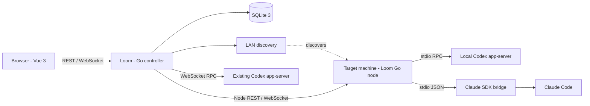

# Loom Design Document

Date: 2026-11-04. Status: first development slice implemented; task-level integration validation and M4 remain outstanding.

This file is shared, version-controlled project documentation. Sections 1-14 retain the target design. Section 15 records the implemented slice and differences from proposed contracts. README commands describe the runnable application.

## 1. Project goals

Loom is a unified controller for Codex and Claude Code. Users start a Go application, open a local browser page, discover and connect to agent services on the local machine or LAN, create sessions in project directories on target machines, submit tasks, observe execution, and continue interacting.

The technology constraints are a Go backend, a Vue 3 frontend, and a SQLite 3 database. The frontend follows the organization and interactions of Times. Codex connectivity follows the existing Times backend implementation.

The first release targets a single user, a small number of machines, and concurrent sessions, with Windows and Linux as the initial platforms. The design baseline is 1-10 target machines and up to 10 concurrent tasks. This is a development and validation target, not a measured performance guarantee.

### 1.1 Required first-release behavior

1. Start the web server when the application starts and print the local browser URL.
2. Automatically discover accessible services when the page opens, with progress, empty states, and errors.
3. Configure connection credentials, add addresses manually, and reconnect saved services.
4. Connect to Codex and Claude Code and select project directories on target machines.
5. Create and restore sessions, submit text tasks, and display live responses and execution activities.
6. Display command output, tool calls, and file changes provided by the agent.
7. Handle supported approval requests and user questions, and interrupt tasks.
8. Persist connection settings, session indexes, messages, execution events, and approval results.
9. Recover task visibility after page refreshes, browser closure, or short network interruptions.

### 1.2 Later scope

Scheduling, orchestration across multiple agents, multi-user permissions, remote desktop control, a complete IDE, arbitrary terminal control, automatic Git commits and merges, attachments, and file management are deferred. Displaying available file change details remains part of the first release.

### 1.3 Integration boundaries

This design interprets "Claude" as Claude Code. Loom connects to programmable agent service endpoints. Ordinary CLI processes and desktop windows do not automatically expose a LAN service.

The first release controls sessions hosted by app-server or Loom nodes. Importing existing desktop client sessions and allowing simultaneous writes from Loom and a desktop client require separate compatibility validation. Taking over arbitrary existing windows is not a first-release commitment.

Agents run on target machines, which retain their authentication state and model provider configuration. Loom stores service connection credentials without copying model API keys or login files from target machines. A remote task's `cwd` belongs to its target machine; the controller's local filesystem cannot establish whether that directory exists.

### 1.4 Project language

All project documentation, code identifiers, comments, UI text, examples, and generated materials use English. This convention is also recorded in `AGENTS.md` for future development.

## 2. Times investigation and protocol verification

The reference project is at `D:\JinYun\code\me\golang\times`. Relevant implementations were read without modifying Times.

| Source | Confirmed behavior | Application to Loom |
| --- | --- | --- |
| [server/define/config.go](D:/JinYun/code/me/golang/times/server/define/config.go) | `Codex.Address`, `Token`, and `WorkspacePath` configuration | Extend a single configured address into multiple endpoints; associate working directories with service identity |
| [server/request/globals.go](D:/JinYun/code/me/golang/times/server/request/globals.go) | `/times/v1/ai/codex` WebSocket route | Use the Go backend as the browser's entry point to agent services |
| [server/request/codex.go](D:/JinYun/code/me/golang/times/server/request/codex.go) | Upstream WebSocket, Bearer authentication, bidirectional relay, heartbeats, and thread constraints | Follow the connection approach and move protocol management into backend adapters |
| [server/request/codexRuntime.go](D:/JinYun/code/me/golang/times/server/request/codexRuntime.go) | Go-side `initialize` / `initialized` handshake and request-response correlation | Reference for backend-owned RPC connections |
| [web/src/base/codex.ts](D:/JinYun/code/me/golang/times/web/src/base/codex.ts) | Thread creation and restoration; turn submission, steering, and interruption; message and activity deltas; reconnection | Map to unified session operations and events |
| [web/src/components/ai/AiDialog.vue](D:/JinYun/code/me/golang/times/web/src/components/ai/AiDialog.vue) | Session sidebar, conversation, input, and live activities | Follow the interactions using smaller components with focused responsibilities |
| [web/src/components/ai/AiActivity.vue](D:/JinYun/code/me/golang/times/web/src/components/ai/AiActivity.vue) | Command, file, tool, and plan displays | Use unified activity types and detail cards |
| [web/package.json](D:/JinYun/code/me/golang/times/web/package.json) | Vue 3, TypeScript, Vite, Element Plus, and Markdown rendering | Select only dependencies needed for the first release |
| [ai/codex/Dockerfile](D:/JinYun/code/me/golang/times/ai/codex/Dockerfile) | app-server listens on WebSocket port 3000 with capability-token authentication | Use 3000 as a configurable native Codex probe port |

Times already connects Codex WebSocket sessions to its UI. The inspected code does not implement LAN agent discovery or a Claude adapter. Its frontend uses `approvalPolicy: never` and returns an unsupported error for server-initiated interactions. Loom must implement approvals and questions rather than treating that branch as existing support.

Times user permissions, its fixed `/workspace`, injected model configuration, and resource library behavior serve its own application. Loom designs working directories, connection credentials, default permissions, and browser origin checks independently. Actual Times credentials must not be copied.

### 2.1 Read-only local verification

- Local `codex --version`: `codex-cli 0.125.0`.
- `codex app-server --help` confirms `stdio://` and `ws://IP:PORT` transports, along with authentication options including `--ws-auth` and `--ws-token-file`.
- This version's `generate-json-schema` exported the protocol to the system temporary directory. The schemas confirm `thread/start`, `thread/resume`, `thread/read`, `turn/steer`, and server approval and question request structures. No agent task was started.
- Local `claude --version`: `2.1.78 (Claude Code)`.
- `claude --help` confirms noninteractive mode, `stream-json` input and output, partial messages, restoration by session ID, and permission modes. The help does not expose a network endpoint equivalent to Codex app-server.
- Official Claude SDK documentation was read to confirm streaming events, restoration by session ID, `canUseTool` approval callbacks, and `AskUserQuestion` interactions.

These results describe local version snapshots. Implementation must pin dependencies and verified versions. New options in current online documentation cannot be assumed to work with older CLIs. These checks do not establish that real service connectivity, login, model calls, approvals, or cross-machine integration have passed.

Official OpenAI app-server documentation was searched and retrieval was attempted, but the page returned HTTP 403. Codex contracts in this document are based on Times source and schemas exported by the local CLI. Implementation must also consult the official documentation and test compatibility against target versions.

## 3. Architecture



The same Go executable provides two operating modes:

- **Controller mode:** the default. Runs the web server, SQLite, discovery, and connection management, and provides the browser API.
- **Node mode:** runs on a target machine. Advertises itself, authenticates the controller, validates working directories, manages local agent processes, and exposes unified interfaces.

Native Codex WebSocket services can be connected directly without installing a node. Claude connects through a node. Nodes can also run on the controller's machine, covering local and remote use through the same model.

The controller maintains one Loom SQLite database. Nodes retain identity and service configuration plus bounded in-memory event buffers. Each agent's native runtime remains responsible for its own session persistence. The first release adds neither node databases nor a central message queue.

### 3.1 Module responsibilities

| Module | Responsibility |
| --- | --- |
| HTTP service | REST routing, validation, errors, frontend assets, and SPA route fallback |
| Discovery | Network interfaces, mDNS, saved addresses, configured-port probes, and deduplication |
| Connection Manager | Credential references, dialing, handshakes, status, reconnection, and connection lifecycle |
| Provider Adapter | Translate unified operations and events to agent-specific protocols |
| Session Service | Session and turn state, operation deduplication, concurrency rules, and history projections |
| Interaction Service | Correlate approval and question requests; handle one-time replies, expiry, and cancellation |
| Event Hub | Deliver persisted events, replay cursors, and manage browser subscriptions |
| Repository | SQLite migrations, transactions, queries, and event projections |
| Node Service | Target directories and processes, node API, and short-term event replay |

The backend owns long-lived agent connections. Switching pages or closing the browser cancels only the browser subscription. It does not close agent connections or interrupt tasks. An explicit "Interrupt" action invokes interruption.

## 4. Technology and directories

### 4.1 Initial choices

- Go: provisionally `1.24+`, subject to the pinned dependencies selected during initialization.
- HTTP: Gin, following the Go web development approach used in Times.
- WebSocket: `gorilla/websocket`, with one read loop and one serialized write queue per connection.
- SQLite: `database/sql` with `modernc.org/sqlite` and SQL migrations. A pure Go driver simplifies Windows builds; an ORM is unnecessary for the first release.
- Frontend: Vue 3 Composition API, TypeScript, Vite, Vue Router, and Element Plus. Start with composable state modules; reconsider Pinia as the application grows.
- Markdown: `markdown-it` with DOMPurify. Agent text and tool results are external input and must be sanitized before rendering.
- Claude bridge: TypeScript with `@anthropic-ai/claude-agent-sdk`, deployed only on target machines using Claude. Node.js 22 is the provisional runtime; implementation pins SDK and runtime versions.
- mDNS: use a maintained Go implementation after checking platform support and maintenance status rather than implementing the DNS protocol from scratch.

Release builds embed frontend assets in the Go application. During development, Vite may serve the frontend and proxy `/api` to Go. A controller using only native Codex connectivity does not need Node.js at runtime. Claude nodes additionally need the SDK bridge runtime.

### 4.2 Proposed layout

```text
loom/
├── cmd/loom/                 # Default controller and node subcommand
├── internal/
│   ├── app/                  # Dependency assembly and lifecycle
│   ├── config/
│   ├── httpapi/
│   ├── discovery/
│   ├── connection/
│   ├── provider/
│   │   ├── codex/
│   │   └── nodeclient/
│   ├── session/
│   ├── interaction/
│   ├── event/
│   ├── storage/migrations/
│   └── node/                 # Node management and Claude bridge adapter
├── bridge/claude/            # Optional SDK bridge with dependency lockfile
├── web/
│   ├── src/
│   │   ├── api/
│   │   ├── types/
│   │   ├── composables/
│   │   ├── components/
│   │   └── views/
│   └── dist/                 # Build output; ignored by Git
├── go.mod
├── README.md
├── DESIGN.md                 # Shared, version-controlled design
└── .gitignore
```

## 5. Startup and discovery

### 5.1 Controller startup

1. Read configuration, create the local data directory, open SQLite, and run migrations.
2. Initialize connection management and the event service. Previously running turns initially require state synchronization.
3. Bind the web port, start HTTP serving, and print the actual browser URL.
4. Reconnect configured endpoints asynchronously. An unavailable agent does not prevent access to the UI.
5. The page obtains a state snapshot, subscribes to events, and invokes discovery. Discovery is asynchronous and does not block the homepage.

The default listener is `127.0.0.1:7331`. Port conflicts produce a clear error. Users can change the port through an option; the application does not silently choose another port. Automatically launching a browser is not required for the first release.

Discovery has a lifecycle independent of browser tabs. Concurrent page loads reuse an active discovery run. After initial discovery, the controller keeps listening for node advertisements and periodically checks saved connections. Full subnet probes run on initial load and the explicit "Discover again" action, with frequency limits.

### 5.2 Discovery sources

| Source | Default behavior | Limitations |
| --- | --- | --- |
| Saved addresses | Probe local and previously configured endpoints using stored credentials | Address changes require an update or rediscovery |
| mDNS | Browse node advertisements for `_loom-agent._tcp.local.` | Nodes must be running; VLAN boundaries or blocked multicast may prevent discovery |
| Bounded port probes | Probe configured ports, initially including 3000, across a limited set of IPv4 addresses on eligible LAN interfaces | Other ports require configuration or manual entry; all-port scanning is not performed |

mDNS TXT records contain only nonsensitive metadata such as protocol version, stable node ID, display name, and provider types. One node can expose both Codex and Claude endpoints. Advertisements identify candidates; they do not establish authentication or permission to execute tasks.

Initial probe limits are 512 IPv4 addresses per run, 32 concurrent probes, a 500ms TCP timeout, a 2s protocol handshake timeout, and a 20s total budget. Large networks retain their actual subnet boundaries. Enumeration stops at the address limit and displays "Discovery scope limited", with options to configure target ranges or enter addresses manually. Loopback, unaddressed, and down interfaces are excluded from subnet scans. VPN and virtual interfaces can be enabled in settings. Loopback services are checked separately as local candidates.

Connections are attempted only on configured ports. Native Codex identity is checked against the `initialize` response structure without creating threads or submitting tasks. An HTTP 401 or open TCP port alone does not identify Codex. Candidates with unknown credentials remain pending configuration or verification until authenticated handshakes succeed.

The first release supports IPv6 addresses returned by mDNS or entered manually, without enumerating IPv6 address space. Results are deduplicated by node ID and provider. Native Codex endpoints without stable node identity are deduplicated by normalized endpoint address.

### 5.3 Connection states

```text
discovered -> connecting -> ready
                        -> auth_required / incompatible / error
ready -> reconnecting -> ready / offline
ready -> disconnected (explicit user action)
```

The ready state establishes transport and protocol availability. Model authentication and quota availability are separate; task failures report them independently. Only configured endpoints with automatic connection enabled are reconnected automatically.

Reconnection uses exponential backoff with jitter: approximately 1, 2, 4, and 8 seconds, capped at 30 seconds. Authentication failures stop automatic retries and prompt for updated credentials. Initial heartbeat intervals are 30 seconds with a 90-second failure threshold, adjustable by adapters for their runtimes.

## 6. Agent adapters

### 6.1 Shared capabilities and interface

The browser depends only on Loom types and cannot submit arbitrary provider RPC. Adapters report capabilities including `stream`, `resume`, `interrupt`, `approvals`, `userInput`, `steer`, `listModels`, and `fileChanges`, together with versions and reasons for unavailable features.

The core Go interface has the following shape; parameter types will be defined during implementation:

```go
type AgentConnection interface {
    Capabilities() Capabilities
    CreateSession(context.Context, SessionOptions) (SessionRef, error)
    RestoreSession(context.Context, SessionRef) (SessionSnapshot, error)
    StartTurn(context.Context, TurnRequest) (TurnRef, error)
    Interrupt(context.Context, TurnRef) error
    RespondInteraction(context.Context, InteractionReply) error
    Events() <-chan AgentEvent
    Close() error
}
```

Optional operations such as steering and model enumeration use separate capability interfaces. Unsupported operations return `capability_unavailable`, and the UI omits their actions. Responses carry the relevant endpoint, session, and turn identifiers; they must not depend on a global current thread.

### 6.2 Codex

1. Connect to the configured `ws://` or `wss://` address. The backend attaches a Bearer token when required.
2. Send `initialize`, wait for success, then send the `initialized` notification.
3. Enable required experimental capabilities according to the actual runtime version. Do not assume `initialize` returns a complete feature list; support is determined from versioned schemas and compatibility tests.
4. Use `thread/start` to create sessions and `thread/read` / `thread/resume` for snapshots, restoration, and subscription synchronization.
5. Submit tasks with `turn/start`, interrupt with `turn/interrupt`, and expose `turn/steer` only after verifying support.
6. Normalize `item/agentMessage/delta`, command output, file changes, tool activities, and `turn/completed` into shared events.

The adapter owns request-response ID correlation. Server requests with IDs are handled separately from ordinary notifications. Required interactions include:

| Codex server request | Loom behavior |
| --- | --- |
| `item/commandExecution/requestApproval` | Display the command, directory, reason, and available choices; map `accept`, `decline`, and `cancel` |
| `item/fileChange/requestApproval` | Display available file changes and the reason; map the corresponding approval result |
| `item/tool/requestUserInput` | Display questions and options; return `answers` keyed by question ID |
| Other interaction types | Implement verified support or return a structured error with a visible reason; never silently leave requests pending |

The first release initially offers "Allow once" and "Deny". Session-level permission, network policy changes, and MCP elicitation are exposed only after validating their contracts. Use verified restricted-workspace and approval settings by default. Native remote Codex workspace restrictions depend on its runtime; controller path validation does not replace process sandboxing.

Two transports are supported: direct native WebSocket connectivity and node-managed `codex app-server --listen stdio://` with newline-delimited JSON. Native WebSocket configuration preserves the full URL path to support reverse proxies with path prefixes.

### 6.3 Claude Code

The primary approach uses a Go node and a small TypeScript SDK bridge. The SDK provides public approval, question, and interruption interfaces, avoiding terminal text parsing or assumptions that Claude shares the Codex protocol.

- The Go node launches the bridge with explicit arguments and validates the process environment and working directory.
- Node and bridge communicate through newline-delimited JSON over stdio. Requests contain `id / method / params`, responses contain `id / result / error`, and events contain `method / params`. This is Loom's internal contract, not a native Claude network protocol.
- Enable SDK `includePartialMessages` and normalize messages, tool activities, and result events.
- Capture the native `session_id` from initialization or result messages and restore the selected ID. Do not substitute the most recent session for the user's selection.
- Route `canUseTool` approval requests through the node and await a one-time reply. Convert `AskUserQuestion` calls into question forms and return the corresponding answers.
- Prefer SDK interruption and cancellation before forcibly terminating a process. Bridge process failures are connection failures.
- Pin CLI and SDK versions on the node. Its handshake reports actual versions and verified capabilities.

The SDK approval callback covers only tools that reach the prompting stage of its permission flow. Existing allow rules may approve tools earlier. Nodes must identify loaded permission settings and the effective policy rather than implying that the UI intercepts every call. Permission bypass is not a default setting.

CLI `-p --output-format stream-json --verbose --include-partial-messages` can be used for protocol investigation. It does not replace the complete interactive approval implementation. Claude support for steering active turns, model enumeration, and file diffs is exposed only after verification; feature parity with Codex is not assumed.

### 6.4 Node API

Nodes expose versioned `/node/v1` interfaces for identity, capabilities, endpoints, session creation and snapshots, turn operations, interaction responses, and event subscriptions. Business fields follow the shared model, while node and browser `/api/v1` interfaces have separate authentication and versioning.

Nodes persist stable identity IDs, and authenticated identities must match saved records. Only explicitly allowed working directories can be selected. Paths are resolved on the target machine, including real directories and symbolic links. This limits the directories Loom selects without replacing agent tool permission policies.

Node and SDK processes are launched with argument arrays. Task text is passed through JSON or stdin rather than interpolated into shell commands. Windows process cleanup uses appropriate mechanisms such as Job Objects; Linux uses process groups. Only processes actually started and owned by the node are cleaned up.

## 7. Data and state

### 7.1 SQLite

The default database is `data/loom.db`, with a configurable location. Connections enable foreign keys, WAL, and a busy timeout. A single write queue organizes transactions in the first release; reads run independently. Migrations finish before HTTP readiness. A migration failure stops startup with a clear error.

| Table | Fields and purpose |
| --- | --- |
| `schema_migrations` | Migration version and execution time |
| `nodes` | Local record ID, stable remote identity, name, address hints, and last discovery time; native endpoints may have no node |
| `endpoints` | ID, nullable node_id, provider, transport, address, credential_ref, auto_connect, version, and capability snapshot |
| `sessions` | ID, endpoint_id, nullable provider_session_id, remote cwd, title, state, model, creation and update times, and archive flag |
| `turns` | ID, session_id, nullable provider_turn_id, client_request_id, input, state, start and finish times, and error |
| `messages` | ID, session_id, turn_id, provider_item_id, role, content, completion flag, and timestamps |
| `activities` | ID, turn_id, provider_item_id, type, state, summary, and detail JSON |
| `interactions` | ID, turn_id, kind, native request_id, connection_generation, payload, state, answer, and timestamps |
| `events` | Monotonic ID, endpoint/session/turn references, source event key, type, payload, and timestamp |
| `settings` | Local preferences and nonsensitive configuration |

Constraints include uniqueness of non-null native session IDs within `(endpoint_id, provider_session_id)`, uniqueness of `(session_id, client_request_id)`, and provider item IDs scoped to their session or turn. Interaction identity includes the connection generation to prevent old RPC IDs from being reused after reconnection.

Claude may provide its native session ID only when the first turn initializes. A local session may therefore exist before that field is populated. The UI always uses stable Loom IDs.

SQLite stores local indexes and observed history. Native agent records retain actual conversation context and restoration data. Local messages must not be replayed to silently construct replacement sessions. Loom archival does not delete native agent history.

### 7.2 Separate state models

- Connection: `discovered / connecting / ready / reconnecting / offline / auth_required / incompatible / disconnected / error`.
- Session: `idle / running / waiting_approval / waiting_input / syncing / error`; archival is a separate flag.
- Turn: `pending / running / waiting_approval / waiting_input / completed / interrupted / failed / unknown`.
- Interaction: `pending / replying / resolved / cancelled / expired / unknown`.

The `unknown` state means execution or completion cannot be confirmed remotely. Disconnection or a process restart does not establish completion or failure. Recovery reads agent state and snapshots before applying supported transitions.

Each session permits one active turn; different sessions may run concurrently. Ordinary submission to a busy session returns `session_busy`. Endpoints supporting steering expose an explicit "Steer" action so sending a message does not silently change meaning with session state.

### 7.3 Event contract

```json
{
  "id": 123,
  "type": "message.delta",
  "endpointId": "endpoint_1",
  "sessionId": "session_1",
  "turnId": "turn_1",
  "time": "2026-11-04T03:00:00Z",
  "data": {"messageId": "message_1", "delta": "Inspecting the project"}
}
```

Initial event types include `discovery.started / candidate / completed`, `endpoint.status`, `session.updated`, `turn.started / completed / failed`, `message.delta / completed`, `activity.updated`, `interaction.requested / resolved / cancelled`, and `sync.required`.

Session events and message or activity projections are persisted in the same transaction, then delivered after commit. Text and command deltas can be batched approximately every 50ms or 4KiB. Turn completion and interaction events are committed immediately. Native completion messages containing final text reconcile accumulated deltas rather than appending duplicate content.

Transient discovery progress and heartbeats do not require persistence. Browser reconnection obtains their current state from snapshots. Only persistent events receive replay cursors; transient events do not advance them. Timestamps are stored in UTC and displayed in the user's timezone.

## 8. Browser API

Business endpoints use `/api/v1`. Successful JSON responses return resource structures. Errors use `{"error":{"code":"...","message":"...","requestId":"..."}}`. Pagination uses cursors. Request bodies, query parameters, and provider payloads have size limits.

| Method and path | Purpose |
| --- | --- |
| `GET /healthz` | HTTP liveness |
| `GET /api/v1/bootstrap` | Configuration summary, endpoint and session states, and a matching event cursor |
| `POST /api/v1/discovery` | Start or reuse asynchronous discovery and return its run ID |
| `GET /api/v1/discovery/:id` | Discovery progress and candidates |
| `GET /api/v1/endpoints` | List endpoints |
| `POST /api/v1/endpoints` | Configure a discovered or manually entered endpoint; accept credentials without echoing them |
| `PATCH /api/v1/endpoints/:id` | Update the address, name, credentials, or automatic connection setting |
| `POST /api/v1/endpoints/:id/connect` | Start connection and handshake |
| `POST /api/v1/endpoints/:id/disconnect` | Disconnect; active turns produce a conflict requiring interruption first |
| `GET /api/v1/sessions` | List session history filtered by endpoint |
| `POST /api/v1/sessions` | Create a session on an endpoint in the specified cwd |
| `GET /api/v1/sessions/:id` | Current session snapshot |
| `POST /api/v1/sessions/:id/restore` | Restore the native session and synchronize state |
| `PATCH /api/v1/sessions/:id` | Rename or archive locally |
| `GET /api/v1/sessions/:id/messages` | Paginated messages and associated activities |
| `POST /api/v1/sessions/:id/turns` | Submit a task with `clientRequestId` |
| `POST /api/v1/turns/:id/interrupt` | Request interruption and confirm it through state events |
| `POST /api/v1/turns/:id/steer` | Steer the specified active turn after capability verification |
| `GET /api/v1/interactions` | List pending approvals and questions |
| `POST /api/v1/interactions/:id/respond` | Respond to the specified interaction |
| `GET /api/v1/events` | WebSocket subscription; `afterCursor` requests persistent event replay |

Task operations first persist intent and return a stable turn ID. User messages retain their failure state even if upstream submission fails. Retrying the same `clientRequestId` returns the existing turn without resubmitting it. Providers may not support idempotency. A request sent without a received acknowledgement therefore becomes unknown and is reconciled against remote state rather than blindly retried.

WebSocket is used for subscriptions; first-release operations use REST. Sensitive tokens never appear in query parameters. Query strings carry nonsensitive values such as replay cursors.

Initial synchronization reads a consistent bootstrap snapshot with cursor C, establishes the event subscription, replays events after C, and then follows the live stream. This closes the gap between snapshot retrieval and subscription. Session snapshots also carry corresponding cursors or versions for frontend deduplication.

## 9. Frontend workspace

Follow the Times session sidebar, conversation view, input area, and activity cards through independent components. Times account management, resource trees, music controls, and unrelated business dependencies are not part of the workspace.

### 9.1 Page layout

- Header: Loom identity, discovery status, "Discover again", and connection settings.
- Sidebar: machines and agents plus sessions for the selected endpoint. Display status indicators alongside error text.
- Conversation header: agent, target machine, working directory, optional supported model selection, and session name.
- Main area: message timeline with expandable tool, command, and file change cards.
- Composer: text input, "Send", a separate "Steer" action, "Interrupt", and execution status.
- Interaction cards: request reasons, operation details, approval choices or question forms, and recorded responses.

Desktop layout supports long-running observation; narrow layouts use a sidebar drawer. Commands and paths use monospaced text. Long output is collapsible. Follow streaming output automatically only when the user is near the bottom; show "New output available" while the user browses earlier messages.

### 9.2 State presentation

Homepage rendering does not wait for scanning. Distinguish "Discovering", "No services available", "Credentials required", and "Connection failed", with manual entry and target setup guidance.

Preserve messages and input drafts after connection loss and indicate pending synchronization. Do not display a disconnected turn as successful. Prevent duplicate submission while requests are pending. Restored interaction cards come from backend state; approvals must not depend on frontend memory.

Explain unavailable capabilities, for example, "This endpoint does not provide file change details". An absent capability is different from a confirmed empty change set. Disable stale approval controls when requests are cancelled, expire, or become invalid after disconnection, and retain the reason.

## 10. Recovery, failures, and access boundaries

### 10.1 Recovery and bounded resources

- Browsers recover from persistent cursors. Queue overflow or expired event history produces `sync.required` and a fresh snapshot.
- Nodes provide replay of up to 4096 in-memory events using connection generations and monotonic source cursors. If the buffer is lost, read native session snapshots.
- Native Codex may not recover every transient command output event. Identify gaps explicitly and preserve recorded output without claiming complete lossless replay.
- After restart, the controller loads SQLite indexes and checks remote state. Recovery must not automatically start replacement tasks.
- Approval replies use one-time state transitions. An old connection generation cannot answer a new request. Lost acknowledgement produces unknown state and result synchronization.
- Interrupt or cancel only associated turns. Nodes attempt to terminate their owned agent subprocesses during shutdown. Forced termination leaves state requiring verification. Controller shutdown does not guarantee that tasks on independent remote nodes stop.

Browser subscriptions have bounded queues so slow clients cannot block agent reads. Output is isolated between turns. Individual messages and details have size limits; large command output is chunked with visible truncation markers. The first release limits concurrent turns and returns an explicit error at capacity rather than adding an implicit task queue.

Persistent event retention is configurable by age or size. Cleanup preserves final message and activity projections, and expired cursors rebuild from snapshots. SQLite write failures are visible recording errors; unpersisted events must not be presented as recoverable.

### 10.2 Credentials and networking

The following implementation constraints follow from remotely executing agent operations:

- The controller listens on loopback by default. Remote node ports and the browser entry point are configured separately.
- Browser APIs validate Host and Origin. WebSocket validates Origin, and development proxies use explicit allowlists. Mutating operations such as POST and PATCH reject external origins to prevent unrelated websites from invoking local controls.
- Initial node connections require a random service token or explicit pairing credentials. Discovery provides neither tokens nor automatic task execution.
- Nodes may use TLS, with clients storing and checking node identity and certificate fingerprints. Plain `ws://` or `http://` is a trusted-LAN deployment setting with an explicit transport boundary.
- Credentials use a separate local secret store; SQLite holds references only. Prefer OS credential storage, with a current-user-only configuration file as fallback. APIs and logs hide secrets.
- Exposing the browser entry point to the LAN also requires browser access authentication. Changing the bind address alone is insufficient.

A node token authorizes controller access to the node. Agent permission policies and individual tool approvals are enforced separately.

## 11. Configuration draft

The following is a proposed configuration structure, not a currently supported file. Real tokens are stored outside this file.

```toml
[web]
bind = "127.0.0.1"
port = 7331

[storage]
path = "data/loom.db"

[discovery]
mdns = true
probe_ports = [3000]
max_hosts = 512
concurrency = 32
scan_budget_seconds = 20

[[endpoints]]
name = "Workstation Codex"
provider = "codex"
transport = "websocket"
address = "ws://192.168.1.20:3000/"
credential_ref = "workstation-codex"
auto_connect = true
```

After initial import, SQLite is authoritative for endpoints. Static configuration is an initial import or explicit update source, preventing startup from overwriting browser edits. Command-line options override runtime configuration. Credential references resolve through the secret store.

Proposed commands are `loom --port 7331` for the controller and `loom node --config <node-config-path>` for a target node. Development and build commands will be added to the README with the application foundation.

## 12. Implementation milestones and validation

| Stage | Deliverables | Required validation |
| --- | --- | --- |
| M1 Foundation | Go startup, SQLite migrations, Vue page, packaged frontend assets, and basic state API | One executable serves the page; database creation works; port conflicts are clear; no-agent states remain usable |
| M2 Codex operations | Manual endpoint connection, handshake, sessions, submission, streaming, and interruption | Complete a turn against a prepared real app-server; output order is correct; interruption has state confirmation |
| M3 Reliable UI | History, activities, approvals and questions, task deduplication, and browser replay | Refresh preserves local history; interactions receive one reply; reconnect avoids duplicate execution; sessions do not mix output |
| M4 Both agents and LAN | Go nodes, mDNS, bounded probes, Claude SDK bridge, and capability-aware UI | Discover and authenticate across two machines; Claude multi-turn restoration and approvals pass; manual connections work when discovery is limited |

M2 is the smallest usable vertical slice. M4 completes the requested interface for both agents with LAN connectivity. Codex-only support does not complete the first-release objective.

### 12.1 Implementation tests

- Adapters: handshake ordering, response correlation, server interactions, reordered or duplicate events, invalid JSON, timeouts, and unsupported capabilities.
- Sessions and storage: migrations, intent deduplication, uniqueness constraints, event/projection transactions, and synchronization from unknown state after restart.
- Event service: snapshot-to-cursor continuity, replay, slow subscribers, buffer gaps, and final message deduplication.
- Discovery: multiple interfaces, duplicate addresses, scope limits, total timeouts, cancellation, unavailable multicast, and authentication failures without false identification.
- Nodes: target-side directory checks, identity matching, secret redaction, process tree cleanup, and bridge failures.
- Integration: simulated agent protocols for failure paths, followed by authorized real Codex and Claude environments for text, tools, approvals, restoration, and interruption.
- Frontend manual checks and necessary E2E coverage: no services, required credentials, failed turns, long output, refresh, multiple tabs, and narrow layouts.

Real agent integration executes tasks and may invoke paid models. Run it only in environments already supplied or authorized by the user. This design work involved file and protocol inspection without live task execution.

### 12.2 Verification before and during implementation

1. Pin target CLI and SDK versions and establish a compatibility matrix. Verify experimental RPC, SDK interruption, and approval callbacks against those versions.
2. Check actual service listeners, authentication, model access, and workspace permissions. TCP readiness alone does not establish complete usability.
3. Verify mDNS on Windows, Linux, target firewalls, and the actual LAN. Use saved or manual addresses where discovery is restricted.
4. Establish the recoverable history and activity detail for each agent and display unrecoverable output gaps explicitly.
5. Implement browser access authentication and deployment settings before enabling LAN access to the UI.

These are implementation and integration work items, not reasons to block the documentation stage awaiting confirmation.

## 13. Tradeoffs and future changes

| Decision | Benefit | Cost or reason to revisit |
| --- | --- | --- |
| Backend-owned protocol and connections | Keep upstream credentials out of the browser, share UI across agents, and separate task lifetime from page lifetime | Adds mapping beyond a transparent proxy and requires ongoing version compatibility |
| Native Codex and Go node entry points | Support existing deployments and agents without native network endpoints | Maintain two transports with shared business contracts and validation |
| Small Claude SDK bridge | Public interfaces for approvals, questions, and streaming | Claude nodes require Node.js; reconsider when a stable Go SDK or native service becomes available |
| mDNS, bounded probes, and manual entry | Combine automatic discovery with practical network fallbacks | Automatic discovery cannot guarantee nondefault ports or cross-subnet coverage |
| One SQLite database and native session restoration | Simple deployment for local single-user use | Multi-controller coordination and complete event recovery require further design |
| Defer automatic orchestration | Focus on real everyday operations | Future scheduling should build on stable session and turn services |

## 14. External references

- [OpenAI Codex app-server](https://developers.openai.com/codex/app-server/): retrieval returned HTTP 403; verify during implementation.
- [Claude Code programmatic usage](https://code.claude.com/docs/en/headless): consulted for noninteractive CLI and streaming behavior.
- [Claude SDK streaming output](https://code.claude.com/docs/en/agent-sdk/streaming-output): consulted for streaming events.
- [Claude SDK approvals and user input](https://code.claude.com/docs/en/agent-sdk/user-input): consulted for approval callbacks and question handling.
- [Claude SDK permissions](https://code.claude.com/docs/en/agent-sdk/permissions): consulted for the permission evaluation flow.
- [Claude SDK sessions](https://code.claude.com/docs/en/agent-sdk/sessions): consulted for restoration by session ID.

## 15. First implementation slice

### 15.1 Delivered and pending work

The runnable foundation uses Go 1.26.1, Gin 1.11.0, Gorilla WebSocket 1.5.3, and modernc SQLite 1.40.1. The frontend uses Vue 3, TypeScript, Vite, Vue Router, Element Plus dialogs/messages, MarkdownIt, and DOMPurify. Exact frontend versions are locked in `web/package-lock.json`.

M1 is implemented: startup, migrations, the state API, frontend build scripts, and embedded production assets. Direct Codex M2 operations are implemented. Live handshake and empty-session creation were verified against Codex 0.125.0; model execution, streaming, and interruption validation remain outstanding. M3 includes persistence, approvals/questions, deduplication, snapshot recovery, replay cursors, and saved browser drafts, with further behavioral coverage required. M4 is not implemented; bounded IPv4 probes provide an initial discovery path.

### 15.2 Concrete contracts

- Runtime configuration uses `--bind`, `--port`, `--data`, and `--probe-ports`. The TOML example in section 11 is still a draft.
- The executable supports controller mode only and rejects non-loopback browser binds. Node mode and browser access authentication are future work.
- Service tokens are separate files under the data directory. Windows encrypts them with user-scoped DPAPI; other platforms use owner-only files. Tokens are not returned in endpoint responses.
- SQLite uses `endpoints`, `sessions`, `turns`, `entries`, `interactions`, and `events`. Entries unify message and execution projections. JSON fields retain provider details; foreign keys and unique submission IDs enforce ownership and deduplication. Nodes and settings tables are deferred.
- The initial event feed carries persisted invalidation records: `{ "id": 123, "type": "session.updated", "resource": "session-id", "createdAt": "..." }`. The browser reloads matching snapshots in a coalesced refresh loop. Dedicated delta payloads and batching from section 7.3 remain planned.
- Bootstrap and session snapshots include a matching persisted cursor. The WebSocket endpoint accepts `afterCursor`; replay reads ordered batches of 100 events and then waits for committed changes. Slow writes close the socket so the browser can resynchronize.
- Implemented REST routes cover bootstrap, endpoint add/update/connect/disconnect, session create/read/rename/restore, task submission, interruption, interaction response, and discovery runs. Separate paginated message endpoints, steering, model enumeration, archival, and endpoint list aliases are not implemented yet.

### 15.3 Recovery behavior

Task intent is committed before `turn/start`. Identical `(session, clientRequestId)` submissions return the existing turn; conflicting text returns a conflict. The controller never automatically repeats an unacknowledged task.

For an unacknowledged turn without a native ID, the controller records the last observed native turn before submission. Under the single-writer, Loom-owned-session constraint, restoration can bind the intent only when one native turn follows that baseline and its user text exactly matches the persisted task. Late notifications can also bind the session's sole pending or unknown intent. Ambiguous snapshots retain unknown state and block further submission.

On the original subscribed connection, synchronization uses `thread/read`. Empty live sessions omit `includeTurns`; the verified runtime rejects it before the first user message. A new connection uses `thread/resume`. An empty session cannot be resumed without a materialized rollout, so the UI explains that a new session is required.

Incomplete native snapshots cannot overwrite already completed entries and preserve newer accumulated prefixes. Terminal snapshots close stale interactions. Approval replies remain `replying` after a successful socket write until `serverRequest/resolved` confirms the request on the same connection generation. Connection loss produces unknown outcomes.

### 15.4 Validation and remaining limits

See [docs/VALIDATION.md](docs/VALIDATION.md) for completed checks and outstanding integration work, and [docs/REVIEW.md](docs/REVIEW.md) for independent review findings and fixes. No performance guarantees or lossless recovery claims have been established. Full first-release completion still requires both agents, nodes, cross-machine discovery validation, and the remaining recovery coverage.
